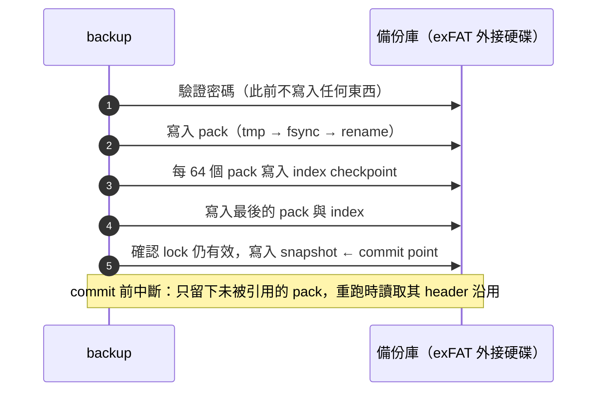
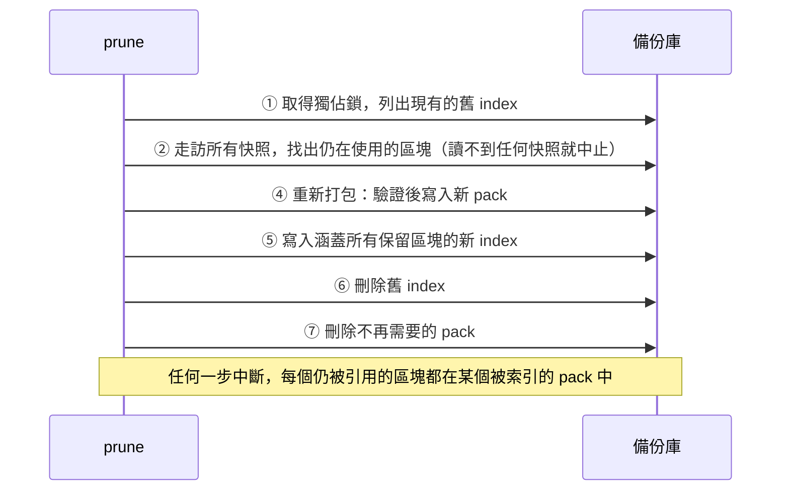

# HomeVault 家用增量備份工具

[](https://github.com/hn83320589/HomeVault/actions/workflows/ci.yml)
[](LICENSE)


為家用電腦設計的增量備份工具：以內容定義切塊（FastCDC）去重、AES-256-GCM 加密，
備份庫放在外接硬碟（exFAT）上，Windows 與 macOS 共用同一個備份庫。
任何時候按 Ctrl+C、拔掉硬碟或斷電，備份庫都不會損毀。

- 內容切塊去重：跨檔案、跨快照、跨兩台電腦，相同內容只存一份
- 加密：scrypt 推導金鑰，所有資料與中繼資料以 AES-GCM 加密，檔名不洩漏任何資訊
- 增量備份：大小與修改時間沒變的檔案完全不讀取
- 中斷安全：以故障注入測試窮舉約 90 個中斷點驗證
- 保留政策（每日、每週、每月、每年）與空間回收（prune 會重新打包部分使用的 pack）

> 完整的系統分析與架構設計請見 [docs/design.md](docs/design.md)。

### 中斷安全的核心：寫入順序

**backup：被引用者先寫，snapshot 最後寫，作為 commit point。** 在 commit 之前任何時間點中斷，
都只會留下沒有被引用的 pack；這些 pack 下次備份會被沿用，既有快照完全不受影響。



**prune：先刪舊 index（⑥），再刪 pack（⑦）。** 順序反過來時，若在兩者之間中斷，
舊 index 會指向已刪除的 pack，下次備份去重時引用到不存在的資料，造成無聲的資料遺失，
這是去重型備份工具最經典的 bug。



---

## 目錄

1. [安裝](#安裝)
2. [快速開始](#快速開始)
3. [指令一覽](#指令一覽)
4. [排程每晚自動備份](#排程每晚自動備份)
5. [備份庫格式](#備份庫格式)
6. [切塊演算法與參數選擇](#切塊演算法與參數選擇)
7. [中斷安全的設計](#中斷安全的設計)
8. [保留政策與清理流程](#保留政策與清理流程)
9. [故障注入測試的設計](#故障注入測試的設計)
10. [效能量測結果](#效能量測結果)
11. [測試與驗收對照](#測試與驗收對照)
12. [已知限制](#已知限制)

---

## 安裝

需求：Python 3.12 以上，以及 [uv](https://docs.astral.sh/uv/)。相依版本鎖定在 `uv.lock`。

```bash
git clone https://github.com/hn83320589/HomeVault.git
cd HomeVault
uv sync                    # 依 uv.lock 建立虛擬環境並安裝鎖定的相依版本
uv run homevault --help    # 在專案內執行
uv tool install .          # （選用）安裝成全域指令 `homevault`
```

沒有 uv 時，也可以用 `python -m pip install .` 安裝。這樣不會使用鎖定版本，但相依套件只有
`cryptography`、`zstandard`、`numpy` 三個。

## 快速開始

```bash
# 1. 在外接硬碟上建立備份庫（會要求輸入兩次密碼）
homevault init --repo /Volumes/Backup/homevault          # macOS
homevault init --repo E:\homevault                        # Windows

# 2. 備份
homevault backup ~/Pictures ~/Documents --repo /Volumes/Backup/homevault \
    --exclude "*.tmp" --exclude node_modules --exclude .DS_Store

# 3. 列出快照、瀏覽內容
homevault snapshots --repo /Volumes/Backup/homevault
homevault ls latest:/Users/mom/Pictures -l --repo /Volumes/Backup/homevault

# 4. 還原整個快照、某個資料夾或單一檔案
homevault restore latest --target ~/restore --repo /Volumes/Backup/homevault
homevault restore 3cacb268:/Users/mom/Pictures/2024 --target ~/restore --repo ...
homevault restore latest:/Users/mom/Documents/報稅.pdf --target ~/Desktop --repo ...
```

每次都輸入 `--repo` 很麻煩，可以改設環境變數 `HOMEVAULT_REPO`。

**密碼來源**（依優先順序）：

1. `--password-file <檔案>`
2. 環境變數 `HOMEVAULT_PASSWORD`
3. 在終端機互動輸入

排程執行時沒有終端機，請使用前兩者。

## 指令一覽

| 指令 | 說明 |
|---|---|
| `init` | 建立新的備份庫 |
| `backup <來源...>` | 建立快照。`--exclude 規則`（可重複）、`--exclude-file 檔案`、`--full-scan`（忽略增量判斷）、`--host`、`--tag`、`--threads N`、`--no-low-priority` |
| `snapshots` | 列出快照（`--host` 篩選主機） |
| `ls <快照>[:路徑]` | 瀏覽快照內的目錄。`-l` 顯示權限、大小與時間，`-R` 遞迴列出 |
| `restore <快照>[:路徑] -t <目標>` | 還原整個快照、資料夾或單一檔案；`--overwrite` 覆寫已存在的檔案 |
| `diff <快照A> <快照B>` | 比較兩個快照：`+` 新增、`-` 刪除、`M` 修改 |
| `check [--read-data]` | 檢查完整性；`--read-data` 會解密並驗證每一個區塊，發現損毀時列出受影響的快照與檔案 |
| `forget` | 依保留政策刪除快照：`--keep-last/hourly/daily/weekly/monthly/yearly N`、`--dry-run`、`--prune`；也可以直接指定快照 ID |
| `prune` | 移除不再被引用的資料，並重新打包部分使用的 pack（`--repack-threshold 百分比`，預設 20） |
| `stats` | 備份庫總大小、原始資料總量、去重後大小、各快照的獨有資料量 |
| `unlock` | 清除殘留的 lock（`--all` 連同看似使用中的 lock 一併清除） |

快照可以用 ID 前綴（至少 1 個字元，必須唯一）或 `latest` 指定。

**排除規則**（不分大小寫）：

| 寫法 | 比對方式 |
|---|---|
| `*.tmp`、`node_modules` | 比對任何層級的檔名或資料夾名稱 |
| `/build`、`photos/cache` | 含 `/`，比對相對於來源資料夾的路徑 |
| `cache/` | 結尾的 `/` 代表只比對資料夾 |
| `#` 開頭的行 | 註解（用於 `--exclude-file`） |

備份庫若位於來源資料夾之內，會自動排除，不會把備份庫備份進自己。

**Exit code：**

| 代碼 | 意義 |
|---|---|
| 0 | 成功 |
| 2 | 參數錯誤 |
| 3 | 部分成功：有檔案沿用舊版本、備份時持續變動、無法備份，或無法還原（詳見輸出） |
| 10 | 密碼錯誤 |
| 11 | 備份庫被另一台電腦鎖定 |
| 12 | 備份庫無法存取（硬碟被拔除？） |
| 13 | `check` 發現損毀 |
| 130 | 使用者按 Ctrl+C 中斷 |

## 排程每晚自動備份

備份預設以**較低的行程優先權**執行，晚上 11 點家人還在用電腦時，不會明顯拖慢速度。

晚上常有程式開著的檔案，備份時會這樣處理：

| 情況 | 處理方式 |
|---|---|
| **被鎖住的檔案或讀不到的資料夾**（開著的 Outlook 資料檔、Excel、資料庫） | 沿用上一個快照中的版本，並標記「自某日起無法更新」。檔案不會從快照中消失，舊版本也會一直被最新快照引用，不會被 prune 清掉。從未成功備份過的檔案則明確列為「無法備份」。 |
| **備份途中被修改的檔案** | 自動重讀一次；仍在變動就保存讀到的內容並標記「內容可能不一致」，下次備份一定重讀。 |

以上情況都會列在備份結果中，並以 exit code 3 結束。`snapshots` 與 `ls` 也會標示這些項目。
連續好幾晚都無法更新的檔案，輸出會顯示「自 2026-11-20 起無法更新，已 3 天」，方便察覺。

先把密碼存成只有自己能讀的檔案：

```bash
# macOS
echo '你的密碼' > ~/.homevault-password && chmod 600 ~/.homevault-password
```

**macOS（cron）**：執行 `crontab -e`，加入：

```cron
0 23 * * * /Users/mom/.local/bin/homevault backup /Users/mom/Pictures /Users/mom/Documents --repo /Volumes/Backup/homevault --password-file /Users/mom/.homevault-password --exclude-file /Users/mom/.homevault-exclude -q >> /Users/mom/homevault.log 2>&1
```

> 若要讓 cron 存取「文件」「照片」等受保護的資料夾，需要在「系統設定 → 隱私權與安全性 → 完整磁碟取用權限」中加入 `/usr/sbin/cron`。

**Windows（工作排程器）**：

```bat
schtasks /create /tn "HomeVault 每晚備份" /sc daily /st 23:00 /tr "C:\Users\Dad\.local\bin\homevault.exe backup C:\Users\Dad\Pictures C:\Users\Dad\Documents --repo E:\homevault --password-file C:\Users\Dad\.homevault-password -q"
```

建議每週再排一次清理：

```bash
homevault forget --keep-daily 7 --keep-weekly 4 --keep-monthly 12 --prune --repo ...
```

---

## 備份庫格式

```
<repo>/
├── config                 明文 JSON：格式版本、repo id、切塊參數、pack 大小（不含任何內容資訊）
├── keys/<sha256>          明文 JSON：scrypt 參數、salt、加密後的 master key
├── data/<前2碼>/<sha256>  pack 檔，分散在 256 個子目錄
├── index/<sha256>         加密的索引檔
├── snapshots/<sha256>     加密的快照檔
├── locks/<隨機>           加密的 lock 檔
└── tmp/                   寫入中的暫存檔
```

除了 `config` 之外，所有檔名都是 64 字元的小寫 hex：

- pack、index、snapshot 的檔名是**密文的 SHA-256**。雜湊的對象是密文，所以不會洩漏內容；同時檔名本身就是校驗碼，`check` 可以直接比對。
- 全部用小寫，適合不分大小寫的 exFAT。

### 金鑰與加密

```
密碼 ──scrypt(N=2^17, r=8, p=1, 隨機 salt)──▶ KEK ──AES-256-GCM 解開──▶ master key
master key = enc_key（32B） ∥ mac_key（32B） ∥ chunker_seed（32B），建立備份庫時隨機產生
```

| 用途 | 做法 |
|---|---|
| 加密所有 blob、index、快照、lock | AES-256-GCM（`enc_key`），格式為 `nonce(12) ∥ 密文 ∥ tag(16)`，nonce 隨機產生 |
| 區塊識別碼 | `HMAC-SHA256(mac_key, 明文)`。沒有金鑰就無法由已知檔案推算出 id，無法用來確認「備份庫裡有沒有某個檔案」 |
| AAD 綁定 | 每個 blob 的 AAD 是 `類型 ∥ blob id`。blob 被調換或 index 指錯位置時，解密會直接失敗 |
| Gear 表 | 由 `chunker_seed` 推導，每個備份庫的切點都不同，攻擊者無法從切塊大小推測內容 |
| 密碼正規化 | 密碼先做 Unicode NFC 正規化，避免 Mac（NFD）與 Windows（NFC）輸入法造成同一個密碼對不上 |

- **密碼錯誤**：解開 key file 時 GCM 驗證失敗，顯示「密碼錯誤，無法開啟備份庫（備份庫未做任何變更）」，exit code 10。密碼驗證一律發生在任何寫入（包括 lock）之前。
- **密碼與 master key 分離**：日後要改密碼時，只需重新加密 key file，不必重寫資料。

### Blob 與 Pack

blob 是儲存的最小單位，分兩種：

- `data`：檔案內容的一個區塊
- `tree`：一個目錄的節點清單

寫入前依序處理：`明文 → zstd 壓縮（壓縮後沒有變小就存原文，以 1 byte flag 標示）→ AES-GCM 加密`。
照片與影片通常壓不小，直接存原文可以省下解壓縮的時間。

Pack 檔把 blob 打包在一起，寫到約 16 MiB 就封檔，避免在外接硬碟上產生數十萬個小檔案。
header 放在**檔尾**，所以可以邊寫邊串流：

```
┌──────────┬──────────┬─────┬──────────────┬────────────────────┐
│ 加密blob │ 加密blob │ ... │ 加密 header  │ header 長度 u32 LE │
└──────────┴──────────┴─────┴──────────────┴────────────────────┘
header 解密後 = 筆數 u32 + 每筆 [type u8 ∥ blob id 32B ∥ offset u32 ∥ length u32 ∥ 原始長度 u32]
```

header 也加密，所以沒有密碼的人連 blob id 都看不到。
它讓 pack 可以**自我描述**：即使 index 遺失，也能從 pack 本身重建索引。

### Index

index 記錄 `blob id → (pack, offset, length, 原始長度, 類型)`。

- 格式：`"HVIX" ∥ 版本 ∥ pack 數 ∥ 每個 pack 的 id 與項目清單`，壓縮後加密。
- 載入時合併 `index/` 底下的所有檔案。同一個 blob 出現在多個 pack 是合法的（中斷後重寫、prune 的過渡狀態）。
- **指向不存在 pack 的項目會被忽略**，避免去重時引用到已刪除的資料。
- 記憶體中把每筆位置編碼成一個整數，約 150 bytes/筆。

### 快照與 Tree（Merkle 結構）

```
snapshot（time, hostname, paths, root tree id, parent, tags, 統計）
   └─ tree blob（根）── tree blob（Users）── tree blob（Pictures）── data blob × N
```

tree blob 是一個目錄底下依名稱排序的節點清單，以 JSON 表示，再壓縮、加密：

```json
{"nodes":[
  {"name":"IMG_0001.jpg","type":"file","size":3145728,"mtime_ns":1700000000123456789,
   "mode":33188,"chunks":["<blob id>", "..."]},
  {"name":"2024","type":"dir","mtime_ns":...,"mode":16877,"subtree":"<tree id>"},
  {"name":"latest","type":"symlink","target":"2024","mtime_ns":...}
]}
```

- 每個 tree 的 id 是它內容的 HMAC，所以**沒有變動的目錄自動去重**。每晚的增量備份只會新增少數幾個 tree blob。`diff` 也可以直接跳過 id 相同的子樹。
- 快照內保留完整路徑。例如 `C:\Users\Dad\Pictures` 存成 `C/Users/Dad/Pictures`，`/Users/mom/Pictures` 存成 `Users/mom/Pictures`。
- 符號連結只記錄連結本身，不跟隨。Windows 的 junction 也當成連結處理，避免 `AppData` 裡指回上層的 junction 造成無窮迴圈。

---

## 切塊演算法與參數選擇

採用 **FastCDC**，搭配 normalized chunking level 2，參數如下：

| 參數 | 值 |
|---|---|
| 最小 / 平均 / 最大 | 256 KiB / 1 MiB / 4 MiB（題目規定） |
| 遮罩 | 未達平均大小時用 22 bits（較難切），超過平均後用 18 bits（較容易切） |
| Hash | gear hash `h = (h << 1) + G[byte]`，取**最高位元**判斷切點 |
| Gear 表 | 256 個 64-bit 值，由每個備份庫的祕密種子以 HMAC-SHA256 推導 |

**為什麼取最高位元：** gear hash 的第 k 個 bit 只受最近 k+1 個 byte 影響。如果用最低的 18 bits 判斷，切點實際上只由最近 18 個 byte 決定。最高位元才涵蓋完整的 64-byte 視窗。

**實測分布**（256 MiB 隨機資料）：平均 1.12 MiB、中位數 1.11 MiB、最小 284 KiB、最大 2.20 MiB，沒有任何區塊被迫切在 4 MiB 上限。
normalized chunking 讓區塊大小集中在平均值附近，去重效果比較穩定。

### 為什麼要用 numpy

純 Python 逐 byte 計算只有 **15 MiB/s**，一般家用電腦上 500 MiB 光切塊就要 60 秒以上。

我們利用一個數學性質：每次左移 1 bit，64 個 byte 之前的資料就會被移出 64-bit 暫存器，所以 gear hash 等同於「最近 64 bytes 的滑動視窗」：

```
W(p) = Σ_{k=0..63} G[data[p-k]] << k   (mod 2^64)
```

這個視窗和可以用 6 次倍增運算一次算完整段資料：`H₂ₖ(i) = Hₖ(i) + Hₖ(i−k) << k`，k = 1、2、4、…、32。
找出所有候選切點後，只剩一個跑幾千次的 Python 迴圈負責套用最小值、最大值與 normalization 規則。
實測速度為 **約 200 MiB/s**。

FastCDC 從最小區塊大小（256 KiB，遠大於 64 bytes）才開始判斷切點，所以向量化版本與逐 byte 版本是**嚴格等價**的，不是近似。
測試中保留純 Python 的參考實作（`reference_chunk_lengths`），並以 Hypothesis 驗證兩者對任意輸入產生完全相同的切點。

**插入 10 bytes 的效果：** CDC 只會改變插入點所在的區塊，下一個切點就重新同步。
在 50 MiB 檔案開頭插入 10 bytes，新增資料約 1–2 個區塊，遠低於 5 MiB 的上限（`test_insert_10_bytes_into_50mib_file_changes_less_than_5mib`）。

---

## 中斷安全的設計

### 三條不變式

1. **只新增、不覆寫：** 既有檔案永遠不會被修改。新檔一律先寫進 `tmp/` → `fsync` → 原子 rename 到正式位置 → `fsync` 目錄。
2. **被引用者先寫，引用者後寫：**
   ```
   pack 檔（fsync）→ index 檔（fsync）→ snapshot 檔（fsync）
   ```
   **snapshot 檔出現的那一刻就是 commit point。** 在此之前中斷，只會留下沒有被引用的檔案，這些檔案不影響正確性，下次會被沿用或由 prune 清除。
3. **讀取端不信任任何檔案：** 每個檔案都有 AEAD tag 或「檔名 = SHA-256」可以驗證。不完整的檔案一律視為不存在，不會被當成正確資料讀出。exFAT 沒有日誌，這是第二道防線。

**平台細節：**

- macOS 的 `fsync` 不會清除磁碟本身的寫入快取，所以改用 `fcntl(F_FULLFSYNC)`。
- Windows 無法對目錄做 fsync，所以以 `MoveFileExW(MOVEFILE_WRITE_THROUGH)` 完成 rename。
- 硬碟被拔除後，macOS 的 `/Volumes/<名稱>` 會消失。程式在建立任何目錄前都會先確認備份庫根目錄還存在，避免在內建硬碟上建立同名目錄，把備份寫到錯的地方。

### backup 的寫入順序

| 步驟 | 動作 | 在此之前中斷會怎樣 |
|---|---|---|
| ① | 驗證密碼（不寫入任何東西） | 沒有任何影響 |
| ② | 建立 lock（共享鎖） | lock 留在備份庫，下次會被判定為殘留並清除 |
| ③ | 載入 index，讀取「沒有被 index 記錄的 pack」的 header 並加回索引 | — |
| ④ | 切塊、加密，累積成 16 MiB 的 pack 後寫入；每 64 個 pack 寫一次 index checkpoint | 已寫好的 pack 下次會被沿用 |
| ⑤ | 由下而上寫 tree blob，寫出最後一個 pack 與 index | 同上 |
| ⑥ | 寫 snapshot ← **commit** | 舊快照完全不受影響 |
| ⑦ | 移除 lock | 快照已完成，只殘留 lock |

**中斷後重跑如何沿用已寫入的區塊：**

- 已寫入 checkpoint 的 pack：index 中已有記錄，直接去重。
- 寫入 checkpoint 之後才完成的 pack：步驟 ③ 只讀它們檔尾的 header（幾 KB），就能把內容加回索引。
- 寫到一半的 pack：還在 `tmp/`，直接忽略。

所以中斷最多損失一個 pack（16 MiB）的進度。

### forget

forget 只刪除 snapshot 檔，每個刪除各自獨立，中斷時只會造成「刪了一部分」。
保留政策具有冪等性：若 K 是要保留的集合，對任何 K ⊆ S′ ⊆ S，policy(S′) = K 都成立。所以重跑結果完全相同（以 Hypothesis 性質測試驗證）。

### prune（最容易出錯的流程）

```
① 取得獨佔鎖，列出目前的 index 檔（之後要刪除的就是這一批）
② 走訪所有快照，得出仍在使用的 blob；任何一個快照讀不到 → 中止，不刪除任何東西
③ 依使用率把 pack 分成：保留 / 刪除 / 重新打包
④ 重新打包：讀出仍在使用的 blob，解密並驗證 HMAC，寫入新 pack
⑤ 寫新 index，涵蓋所有保留的 blob
⑥ 刪除 ① 列出的舊 index
⑦ 刪除不再需要的 pack
```

**⑥ 一定要在 ⑦ 之前。** 如果先刪 pack 再刪 index，中斷時舊 index 仍指向已刪除的 pack。
下次備份會以為 blob 已經存在而跳過寫入，新快照就會引用到不存在的資料，造成**無聲的資料遺失**。這是去重型備份工具最經典的 bug。

| 在哪一步中斷 | 狀態 | 為什麼安全 |
|---|---|---|
| ④ 期間或之後 | 多出沒有被 index 記錄的新 pack | 舊 index 與舊 pack 都完整；重跑時會優先保留新 pack |
| ⑤ 之後 | 新舊 index 並存，blob 出現在兩個 pack | index 載入允許重複 |
| ⑥ 期間 | 部分舊 index 已刪除 | 新 index 涵蓋所有保留的 blob |
| ⑦ 期間 | 部分 pack 已刪除 | 已經沒有任何 index 指向它們 |

### Lock

- `backup` 只會新增檔案，用**共享鎖**，可以和另一個 backup 同時進行。
- `forget` 與 `prune` 會刪除檔案，用**獨佔鎖**。
- `check`、`restore`、`ls`、`diff`、`stats` 也取得共享鎖，避免另一台電腦同時 prune 時讀到一半資料被移走。
- 取得鎖的流程：先寫自己的 lock 檔，再列出 `locks/` 檢查是否衝突，以處理兩台電腦同時建立 lock 的競爭。

執行中每 5 分鐘更新一次 lock 的時間。符合下列任一條件的 lock 會被判定為殘留並自動清除：

- 超過 30 分鐘沒有更新；
- 同一台電腦上，建立它的行程已經不存在。

其他情況下指令會拒絕執行，並顯示「備份庫正在被使用：<主機名稱>（最後更新於 …）」，提示可以用 `homevault unlock` 手動清除。

**失去 lock 的偵測：** 如果電腦睡眠或硬碟停頓超過 30 分鐘，另一台電腦可能把我們的 lock 判定為殘留而移除，並開始 prune。
因此 backup 在寫出最後的 pack 與提交快照前、forget 與 prune 在每個刪除步驟前，都會呼叫 `Lock.check_held()`：
太久沒更新就立刻補更新；補更新時若發現舊的 lock 檔已被別人刪除，代表這段期間沒有受到保護，立即中止、不提交快照。

### Ctrl+C 與拔除硬碟

- **Ctrl+C：** 背景執行緒在下一個區塊就停止，程式清除自己的暫存檔並釋放 lock，exit code 130。
- **拔除硬碟：** 所有 I/O 錯誤都會被轉換成清楚的訊息：「無法存取備份庫（外接硬碟是否被移除？）已完成的部分下次執行時會自動沿用。」

---

## 保留政策與清理流程

```bash
homevault forget --keep-daily 7 --keep-weekly 4 --keep-monthly 12 --dry-run   # 先看會刪哪些
homevault forget --keep-daily 7 --keep-weekly 4 --keep-monthly 12 --prune     # 刪除並清理
```

- **分組：** 依「主機名稱 + 來源路徑」分組，Windows 與 Mac 的快照各自計算保留政策。
- **時間桶：**

  | 規則 | 時間桶 |
  |---|---|
  | `hourly` | 年月日時 |
  | `daily` | 年月日 |
  | `weekly` | ISO 年週（例如 2021-01-01 屬於 2020-W53） |
  | `monthly` | 年月 |
  | `yearly` | 年 |
  | `last` | 每個快照各自一桶 |

  時間桶依快照建立時的**本地時間**（含時區 offset）計算。
- **演算法：** 每條規則由新到舊掃描，遇到新的時間桶且配額還沒用完，就保留這個快照（它是該桶最新的一個）。只要被任何一條規則保留，就保留。
- **「最近 7 天」指有快照的 7 個日子：** 電腦關機兩週後再開機，舊的每日快照不會因為日曆天過了而全部被刪光。
- **安全網：** 必須至少指定一條規則，否則拒絕執行。最新的快照一定會被保留。
- **prune 的重新打包：** pack 中未使用資料的比例超過 `--repack-threshold`（預設 20%）時，重新打包以回收空間；低於門檻的 pack 保留不動，避免為了回收一點點空間而重寫 16 MiB。重新打包時，每個 blob 都會先解密並驗證 HMAC；發現損毀就中止，不刪除任何東西。

---

## 故障注入測試的設計

所有對備份庫的寫入都經過 `LocalBackend`，會改變狀態的動作被拆成五種基本操作：
`_op_write`、`_op_fsync`、`_op_rename`、`_op_delete`、`_op_mkdir`。
測試用的 `FaultInjectingBackend`（`tests/faults.py`）覆寫這些操作，在第 k 個操作上模擬當機：

- 拋出 `SimulatedCrash`。它繼承 `BaseException`，不會被一般的 `except Exception` 攔下，最接近行程突然死亡。
- 如果被中斷的是 write，只寫入一半的資料（torn write）。
- 當機後，所有操作（包括讀取與清理暫存檔）都會失敗，就像行程已經不存在。
- **斷電模式：** 還沒 fsync 的檔案被截斷成隨機長度，模擬磁碟寫入快取遺失。

**窮舉而不是抽樣。** 測試先建立一份範本（備份庫加上來源資料夾，含 4 個既有快照）。
每個案例都從範本複製出完全相同的狀態，金鑰與資料都相同，所以第 k 個操作永遠是同一個動作。
這樣就能對每一個操作都測試一次：

| 流程 | 中斷點數量（每次執行略有不同） |
|---|---|
| backup | 約 25 |
| backup（每 2 個 pack 寫一次 checkpoint，涵蓋備份途中寫 index） | 約 31 |
| forget | 6 |
| prune（含重新打包） | 約 27 |
| 斷電模式（backup、prune 各 6 個位置） | 12 |

每次中斷後都會驗證：

1. `check --read-data` 通過；
2. 中斷前已存在的快照全部能完整還原，內容雜湊與 mtime 都相同；
3. 重新執行原本的指令能成功完成，之後 `check --read-data` 仍然通過，結果也符合預期（例如 prune 後備份庫確實變小）。

另外還有兩個測試以**真實子行程**中斷備份（`tests/test_interrupt_process.py`）：

- `SIGKILL`（Windows 上是 `TerminateProcess`），程式沒有任何清理的機會；
- Ctrl+C（`SIGINT`）：驗證 lock 已釋放、暫存檔已清除、exit code 130。

兩者都驗證重跑時會沿用中斷前寫入的資料。

這套測試在開發過程中實際抓到幾個 bug：

- `Lock.acquire` 中途失敗時，session 沒有失效，殘留的 lock 會被同一個行程誤判為使用中。
- 硬碟被拔除後，`mkdir(parents=True)` 會在內建硬碟上重建備份庫目錄。

---

## 效能量測結果

用 `uv run python benchmarks/bench_backup.py` 重現。腳本以固定亂數種子產生資料，透過真正的 CLI 子行程執行，量測時間包含行程啟動與 scrypt 金鑰推導。

- **測試機器：** Apple M4 Pro（12 核）、24 GB RAM、內建 SSD，macOS 27.2.1、Python 3.12.15
- **資料：** 513 MiB、2,122 個檔案
  - 照片：313 MiB，120 個不可壓縮檔案
  - 影片：100 MiB，2 個不可壓縮檔案
  - 文件：100 MiB，2,000 個可壓縮的文字檔

| 項目 | 結果 |
|---|---|
| **首次備份（預設 4 個執行緒）** | **2.1 秒（約 248 MiB/s）** |
| 首次備份（`--threads 1`） | 3.8 秒（約 135 MiB/s） |
| 增量備份（沒有任何變動） | 0.3 秒 |
| `check`（結構檢查） | 0.3 秒 |
| 備份庫大小 | 432 MiB（文件壓縮後，原始資料的 84%） |
| 切塊器本身 | 約 200 MiB/s（純 Python 參考實作約 15 MiB/s） |

驗收標準是 60 秒內完成，單執行緒也還有約 15 倍的餘裕。

注意：資料是剛產生的，讀取時多半命中作業系統快取。實際備份時，速度通常受限於來源硬碟與外接硬碟的讀寫速度（USB 3 的外接 HDD 約 100 MiB/s）。

---

## 測試與驗收對照

```bash
uv run pytest            # 全部測試（約 270 個，其中約 130 個是故障注入的中斷點）
uv run pytest -m "not slow"
uv run ruff check . && uv run ruff format --check .
```

| 驗收項目 | 測試 |
|---|---|
| 1. 依 README 安裝並初始化、備份、列出快照、還原 | `tests/test_cli.py::test_full_workflow_init_backup_snapshots_ls_restore` |
| 2. 1,000+ 個檔案、空檔、>100 MiB、中文與 emoji 檔名，雜湊與 mtime 相同 | `tests/test_backup_restore.py::test_acceptance_1000_files_with_large_file_unicode_and_empty` |
| 3. 50 MiB 檔案插入 10 bytes，新增 < 5 MiB | `tests/test_chunker.py::test_insert_10_bytes_into_50mib_file_changes_less_than_5mib` |
| 4. 兩台電腦備份同一份資料，第二次新增 < 1% | `tests/test_backup_restore.py::test_cross_host_backup_deduplicates`，以及 CI 的跨 OS job |
| 5. 密碼錯誤時讀不到資料、訊息清楚、備份庫不變 | `tests/test_security.py::test_wrong_password_reads_nothing_and_changes_nothing`（涵蓋 10 個指令） |
| 6. 備份庫不洩漏檔名或內容雜湊 | `tests/test_security.py`：以 UTF-8、UTF-16、NFC/NFD 搜尋檔名，並搜尋 SHA-256、SHA-1、MD5（含 hex） |
| 7. 未變動的檔案不重新讀取 | `tests/test_backup_restore.py::test_incremental_backup_does_not_read_unchanged_files`（計數用的 opener 測試替身） |
| 8. 保留政策：跨月、跨年 | `tests/test_retention.py`（含 ISO 週 53、閏年，以及與參考答案比對的性質測試） |
| 9. prune 後可完整還原、備份庫變小 | `tests/test_forget_prune.py::test_prune_reclaims_space_and_keeps_snapshots_restorable` |
| 10. 故障注入 ≥ 20 個中斷點 | `tests/test_fault_injection.py`（約 89 個中斷點加 12 個斷電案例）、`tests/test_interrupt_process.py` |
| 11. 損壞一個 byte，偵測並列出受影響的快照與檔案 | `tests/test_check.py::test_single_corrupted_byte_is_detected_and_affected_files_listed` |
| 12. 500 MiB 在 60 秒內完成 | `benchmarks/bench_backup.py`，結果見上節 |
| 13. ≥ 45 個測試全數通過 | 約 270 個 |

---

## 已知限制

- **記憶體：** 索引約 150 bytes/區塊。2 TB（約 200 萬個區塊）時約 300 MB RAM。
- **檔名不做 Unicode 正規化：** 為了還原時完全一致，檔名保持作業系統給的原樣。macOS 若以 NFD 儲存「é」而 Windows 以 NFC 儲存，兩邊的 tree 會不同，但檔案內容的區塊仍然會去重。
- **還原到 exFAT：** mtime 精度只有 10 ms，這是檔案系統的限制。驗收測試是還原到本機磁碟。
- **備份時被修改的檔案：** 沒有使用 VSS 或檔案系統快照。讀取期間被修改的檔案會自動重讀一次，仍在變動就標記為「內容可能不一致」，下次一定重讀。被鎖住的檔案只能沿用舊版本，無法取得當晚的內容（需要 VSS 才能讀取被鎖住的檔案）。
- **Windows 上的符號連結：** 還原符號連結需要系統管理員權限或開發人員模式。沒有權限時會警告並略過。
- **權限：** Windows 只保存與還原唯讀屬性。跨平台還原時，權限位元依原始平台的設定套用。
- **Hard link 與稀疏檔案：** hard link 會被當成獨立的檔案（內容仍會去重）；稀疏檔案還原後不再是稀疏檔案。
- **單一目錄極大時：** 一個目錄對應一個 tree blob，數十萬個檔案放在同一個目錄時，這個 blob 會很大。
- **網路磁碟上的 lock：** lock 的原子性依賴檔案系統。在網路磁碟上遇到極端的時序競爭時無法完全排除，請避免兩台電腦同時執行 prune。
- **check 的速度：** 結構檢查會讀取每個 pack 的 header。在外接 HDD 上有十萬個 pack 時，會花上數分鐘。
- **還原速度：** 還原時逐一讀取區塊，沒有平行化。
- **改密碼：** 格式上已經支援（key file 與 master key 分離），但目前沒有提供指令。
- **Windows 上刪除檔案的持久性：** Windows 無法對目錄做 fsync。forget 刪除快照後若立刻斷電，被刪除的快照檔有機會「復活」；若它引用的資料已被 prune 移除，之後的 prune 會中止並提示先執行 check，需要再 forget 一次該快照。既有、未被 forget 的快照不受影響。
- **主機名稱變動：** parent 快照與保留政策依主機名稱分組。macOS 的主機名稱可能隨網路環境改變（例如 `.local` 與 `.lan`），此時會失去增量判斷（改為完整讀取，但去重仍然有效）。可以用 `--host` 固定名稱。
- **斷電模型：** 故障注入的斷電模式只模擬「沒有 fsync 的檔案內容遺失」，沒有模擬檔案系統中繼資料本身的損毀。exFAT 本身的損毀由讀取端的驗證處理：不完整的檔案會被視為不存在。

---

## 授權

[MIT License](LICENSE)
