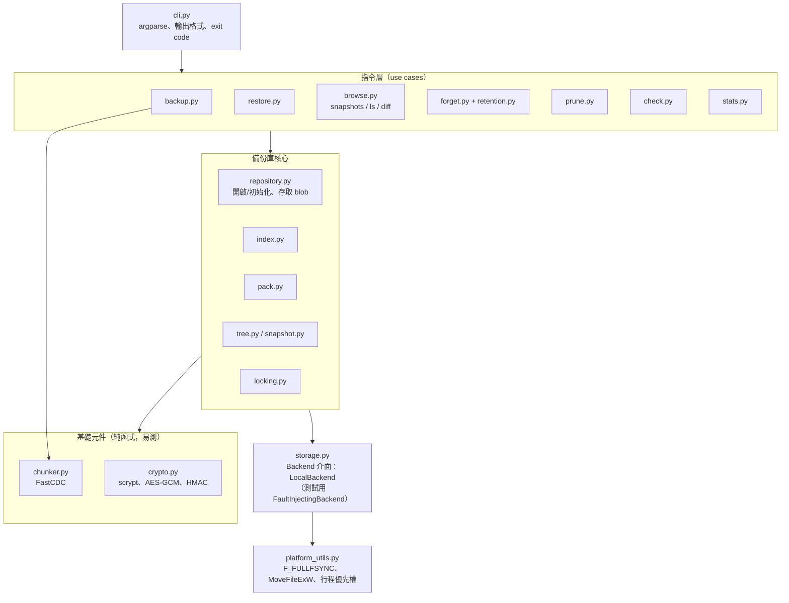
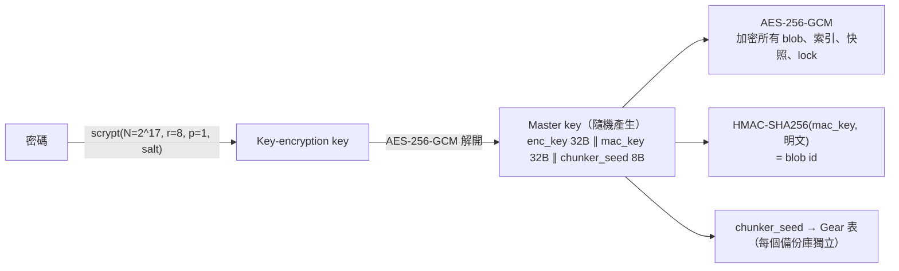
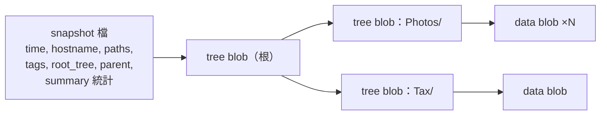
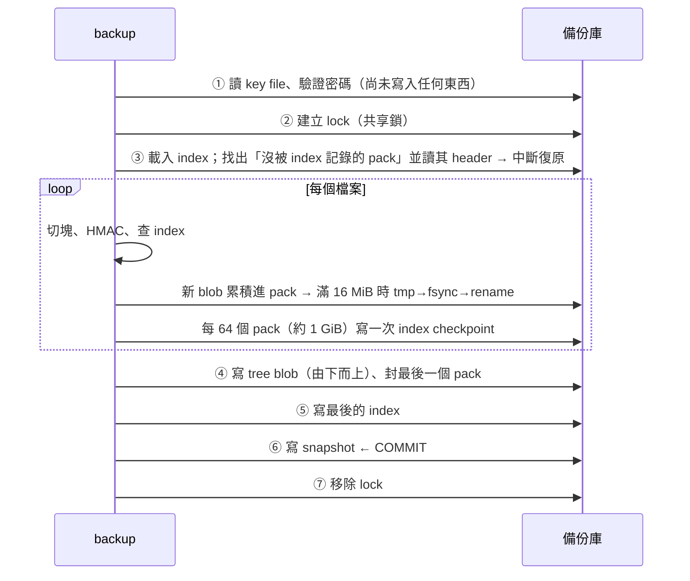

# HomeVault 系統分析與架構設計

> 狀態：**已確認**（v1.0，2026-11-23）
> 標示 🔶 的項目已於討論中確認：採用 numpy、「有快照的最近 N 天」語意、依「主機 + 來源路徑」分組、argparse、uv + ruff。

---

## 1. 需求分析

### 1.1 使用情境與隱含需求

題目的客戶背景隱含了幾個驗收標準沒直接寫出、但設計上必須處理的情境：

| 情境 | 推導出的需求 | 設計對應 |
|---|---|---|
| 每晚 11 點自動執行，**常常還有人在用電腦** | 不可霸占 CPU/磁碟；執行時檔案可能正被修改或被鎖住 | 預設降低行程優先權；讀檔前後比對 stat，變動則警告；被鎖住的檔案（Windows）略過並回報，不讓整次備份失敗 |
| 排程執行，**沒有人在旁邊輸入密碼** | 非互動式提供密碼 | `--password-file`、環境變數 `HOMEVAULT_PASSWORD`、互動式 `getpass` 三種來源 |
| 家人**直接拔走外接硬碟** | 任何 I/O 都可能突然失敗，且 lock 檔來不及清除 | 寫入順序保證一致性（§5）；殘留 lock 的判定與 `unlock` 指令（§5.5） |
| 兩台電腦（Windows + Mac）**共用一個備份庫** | 跨平台路徑、檔名、時間精度；另一台電腦可能還留著 lock | 統一使用 `/` 分隔的相對路徑；共用 key 與 chunker 參數；lock 記錄主機名稱 |
| 備份庫在 **exFAT** | exFAT 沒有日誌（journal）、沒有 hard link、不分大小寫、mtime 精度 10ms | 只建立新檔，不覆寫既有檔案；所有檔案自帶驗證（AEAD）；檔名一律小寫 hex |
| 硬碟裡**已有十幾份重複副本** | 去重是主要價值 | 內容切塊 + HMAC 識別碼 + 跨主機共用索引 |
| 上限 **2 TB、200 萬個檔案** | 記憶體與中繼資料大小要可控 | Merkle tree 形式的快照（未變動的目錄不重存）；精簡的記憶體索引 |

### 1.2 品質屬性優先順序

1. **資料不可損毀**（中斷安全、完整性）：這是備份工具存在的理由
2. **隱私**（加密、不洩漏檔名或雜湊）
3. **空間效率**（去重、壓縮、prune）
4. **效能**（500 MiB < 60 秒）
5. **易用性**（清楚的錯誤訊息、進度顯示）

發生衝突時依此順序取捨。例如：寫入時一律 fsync，即使會慢一些。

### 1.3 範圍外（依假設事項）

雲端後端、多使用者權限、ACL/延伸屬性/資源分支、跟隨符號連結、GUI、內建排程器。

---

## 2. 關鍵技術風險與驗證

| 風險 | 驗證結果 | 結論 |
|---|---|---|
| 純 Python 自行實作的 CDC 太慢 | 在 M4 Pro 上用 prototype 實測：純 Python gear hash **15 MiB/s**；numpy 向量化 **173 MiB/s**（單執行緒），兩者在前 64 bytes 之後的結果逐一比對完全相同 | 🔶 **建議使用 numpy 實作快速路徑**，純 Python 版本保留為參考實作與測試對照組 |
| exFAT 沒有日誌，斷電時 rename 不保證原子性 | 理論分析 | 不能只依賴 rename 的原子性，讀取端也要能辨識並略過不完整的檔案（§5.1） |
| 200 萬個 blob 的記憶體索引 | 估算：Python dict 每筆約 150 B，總共約 300 MB | 可接受，列入已知限制；索引值用 int 編碼以壓低用量 |

> **為什麼純 Python 不夠：** 15 MiB/s 是目前最快的消費級 CPU 測出來的數字。一般家用 Windows 電腦大約只有 5–8 MiB/s，500 MiB 光切塊就要 60–100 秒，還沒算壓縮、加密與 I/O。

---

## 3. 整體架構

### 3.1 分層



**設計原則：**

- **所有對備份庫的寫入都經過 `Backend` 介面。** 這是故障注入測試的接縫（seam）：測試時換成 `FaultInjectingBackend`，就能在第 N 次寫入、rename、刪除時模擬中斷。
- **保留政策（retention）、切塊、加密都是純函式**，不碰檔案系統，可以用單元測試與 Hypothesis 性質測試徹底驗證。
- 指令層不直接操作檔案路徑，只透過 `Repository`。

### 3.2 專案目錄結構

```
HomeVault/
├── pyproject.toml / uv.lock
├── README.md
├── docs/design.md
├── src/homevault/
│   ├── cli.py            # 指令解析與輸出
│   ├── errors.py         # 例外階層 → exit code 對應
│   ├── chunker.py        # FastCDC：reference（純 Python）+ fast（numpy）
│   ├── crypto.py         # KDF、key file、seal/open、blob_id
│   ├── storage.py        # Backend 抽象、LocalBackend、原子寫入
│   ├── platform_utils.py
│   ├── pack.py           # pack 格式讀寫
│   ├── index.py          # 記憶體索引與 index 檔格式
│   ├── tree.py           # 目錄節點（Node/Tree）序列化
│   ├── snapshot.py
│   ├── repository.py
│   ├── locking.py
│   ├── backup.py         # 走訪、增量判斷、排除規則、pipeline
│   ├── restore.py
│   ├── browse.py         # snapshots / ls / diff
│   ├── retention.py      # 保留政策（純函式）
│   ├── forget.py
│   ├── prune.py
│   ├── check.py
│   ├── stats.py
│   └── progress.py
├── tests/                # 依模組分檔，另有 tests/faults/ 故障注入
├── benchmarks/bench_backup.py
└── .github/workflows/ci.yml
```

---

## 4. 備份庫格式

### 4.1 目錄配置

```
<repo>/
├── config                 # 明文 JSON：格式版本、repo id、KDF 演算法。不含任何內容資訊
├── keys/<keyid>           # 明文 JSON：scrypt 參數、salt、加密後的 master key
├── data/<2 hex>/<packid>  # pack 檔，以 256 個子目錄分散（2 TB ÷ 16 MiB ≈ 12.5 萬個檔）
├── index/<id>             # 加密的索引檔
├── snapshots/<id>         # 加密的快照檔
├── locks/<id>             # 加密的 lock 檔
└── tmp/                   # 寫入中的暫存檔；開啟時清除超過 24 小時的殘留
```

**檔名規則：** 全部是 64 字元小寫 hex。`packid`、index id、snapshot id 都是**該檔案密文的 SHA-256**。因為雜湊的對象是密文，檔名不會洩漏內容；而且檔名本身就是校驗碼，`check` 可以直接驗證「檔名 == SHA-256(檔案內容)」。

### 4.2 金鑰與加密



- **密碼與 master key 分離：** 將來要改密碼時，只需要重新加密 key file，不必重寫資料。題目沒要求改密碼功能，但這個結構不增加成本。
- **錯誤密碼：** 解開 key file 時 GCM 驗證失敗，拋出 `WrongPasswordError` → 顯示「密碼錯誤，備份庫未做任何變更」，exit code 10。**驗證密碼一律發生在任何寫入（包括 lock）之前。**
- **加密物件格式：** `nonce(12B) ∥ ciphertext ∥ tag(16B)`，nonce 隨機產生。2 TB ÷ 1 MiB ≈ 200 萬個 blob，遠低於隨機 96-bit nonce 的安全上限（2³²）。
- **AAD 綁定：** blob 的 AAD = `type ∥ blob_id`。這樣即使 index 指錯位置，或攻擊者把兩個 blob 對調，解密也會失敗，而不是悄悄還原出錯誤的內容。
- **Gear 表由 master key 推導：** 每個備份庫的切塊邊界都不一樣，攻擊者無法用「已知檔案的切塊大小序列」去比對、推測備份庫裡有什麼（restic 也這樣做）。兩台電腦共用同一個備份庫，Gear 表相同，所以跨主機去重不受影響。
- **scrypt 參數**存在 key file 中，將來可以調整。N=2¹⁷ 大約需要 128 MiB 記憶體與 0.3–0.5 秒。

### 4.3 Blob 與 Pack

**Blob** 是儲存的最小單位，分兩種：

- `data`：檔案內容的一個區塊
- `tree`：一個目錄的節點清單（§4.5）

每個 blob 寫入前的處理順序：`明文 → zstd 壓縮（壓縮後沒有變小就存原文，以 1 byte flag 標示）→ AES-GCM 加密`。照片與影片通常壓不小，這樣可以避免白白浪費解壓縮時間。

**Pack 檔格式**（header 放在檔尾，可以邊寫邊串流，不必事先知道有哪些 blob）：

```
┌──────────────┬──────────────┬─────┬──────────────────────┬──────────────────┐
│ 加密 blob #1 │ 加密 blob #2 │ ... │ 加密 header           │ header 長度 u32LE │
└──────────────┴──────────────┴─────┴──────────────────────┴──────────────────┘
header（解密後）= 每個 blob 一筆：type(1) ∥ blob_id(32) ∥ offset(u32) ∥ length(u32) ∥ raw_length(u32)
```

- 寫到約 16 MiB 就封檔。tree blob 可能超過 4 MiB（例如單一目錄有十萬個檔案），這種情況允許 pack 超過目標大小。
- header 也加密：沒有密碼的人看不到 blob id。
- header 讓 pack 檔**可以自我描述**：即使 index 遺失，也能從 pack 重建（中斷復原會用到，§5.3）。

### 4.4 Index

- 記錄 `blob_id → (pack_id, offset, length, raw_length, type)`。
- 檔案格式：`zstd(固定長度二進位紀錄)` → 加密。
- 載入時合併 `index/` 下所有檔案。同一個 blob 出現在多個 pack 是**合法的**（中斷後重複寫入、prune 過程中的過渡狀態），任選一個仍存在的 pack 即可。
- 載入時會列出 `data/`，**忽略指向不存在 pack 的 index 項目**。這是防禦性設計，避免去重時引用到已刪除的資料（§5.4）。

### 4.5 快照與 Tree（Merkle 結構）



**Tree blob** = 一個目錄底下依名稱排序的節點清單（JSON → 壓縮 → 加密）：

```json
{"nodes": [
  {"name": "IMG_0001.jpg", "type": "file", "size": 3145728,
   "mtime_ns": 1700000000123456789, "mode": 33188, "chunks": ["<hex id>", ...]},
  {"name": "2024", "type": "dir", "mtime_ns": ..., "mode": 16877, "subtree": "<hex id>"},
  {"name": "latest", "type": "symlink", "target": "2024", "mtime_ns": ...}
]}
```

**為什麼不用「一個快照一份大清單」：** 200 萬個檔案的清單大約有 300 MB。採 Merkle 結構時，tree 的 id 就是它內容的 HMAC，沒有變動的目錄會得到相同 id，自動去重。每晚增量備份通常只會新增幾個 tree blob。`diff` 也可以直接跳過 id 相同的子樹，所以很快。

**跨平台處理：**

- 檔名保留作業系統給的原樣，不做 Unicode 正規化。目的是還原時完全一致，但這會影響跨平台比對，見 §10。
- 來源路徑：Windows 的 `C:\Users\Mom\Pictures` 存成 `C/Users/Mom/Pictures`，macOS 存成 `Users/mom/Pictures`。`paths` 欄位另外保留原始字串。
- `mode`：在 Windows 上只有唯讀屬性有意義，還原時只套用到 OS 支援的部分。

---

## 5. 中斷安全設計（核心）

### 5.1 三條不變式

1. **只新增、不覆寫：** 既有檔案永遠不會被修改。新檔一律寫進 `tmp/` → `fsync` → rename 到正式位置 → `fsync` 目錄。
2. **引用只能指向已持久化的物件：** 寫入順序永遠是「被引用者先，引用者後」：

   ```
   pack 檔（fsync）→ index 檔（fsync）→ snapshot 檔（fsync）
   ```

   **snapshot 檔出現的那一刻就是 commit point。** 在它之前中斷，只會留下未被引用的垃圾；垃圾不影響正確性，prune 會清除它。
3. **讀取端不信任任何檔案：** 每個檔案都有 AEAD tag 或 SHA-256 檔名可驗證。不完整或損毀的檔案一律視為「不存在」，而不是讀出錯誤資料。這是針對 exFAT 沒有日誌的第二層防護。

**平台細節：**

- macOS 的 `fsync` 不會清除磁碟快取，必須用 `fcntl(F_FULLFSYNC)`。
- Windows 無法對目錄做 fsync，改以 `ctypes` 呼叫 `MoveFileExW(..., MOVEFILE_WRITE_THROUGH | MOVEFILE_REPLACE_EXISTING)`。

### 5.2 backup 的寫入順序



**中斷後重跑如何沿用已寫入的區塊（需求 7）：**

- 已 checkpoint 的 pack：index 已經有記錄，直接去重。
- checkpoint 之後才寫好的 pack：步驟 ③ 會讀它們的 header（每個 pack 只讀檔尾幾 KB），加回記憶體索引，並補寫一份 recovery index。
- 寫到一半的 pack：還在 `tmp/`，直接忽略。最多損失一個 pack（16 MiB）的進度。

### 5.3 forget 的寫入順序

forget 只會刪除 snapshot 檔。每個檔案的刪除是獨立的，中斷時只會造成「刪了一部分」。

**冪等性保證：** 設 policy(S) = K 為要保留的集合。對任何滿足 K ⊆ S′ ⊆ S 的 S′，policy(S′) = K 都成立，因為被保留的快照依然存在，每個時間桶裡最新的快照不變。所以中斷後重跑會得到相同結果。這條性質會用 **Hypothesis 性質測試**驗證。

### 5.4 prune 的寫入順序（最容易出錯）

```
① 取得獨佔鎖（exclusive lock）
② 讀取所有快照、走訪所有 tree → used_blobs
   任何一個 tree 讀不到 → 中止，不刪任何東西
③ 依使用率把 pack 分類：
   全部在用 → 保留 ／ 全部沒用 → 刪除 ／ 部分在用 → 未使用比例 > 20% 才重新打包
④ 重新打包：讀出仍在用的 blob，解密並驗證 HMAC，寫入新 pack（tmp→fsync→rename）
⑤ 寫新 index：涵蓋所有保留的 blob（fsync）。舊 index 清單在 ① 之後就先列好，避免誤刪新檔
⑥ 刪除舊 index 檔
⑦ 刪除不再需要的 pack 檔
⑧ 釋放鎖
```

**關鍵：⑥ 必須在 ⑦ 之前。** 如果先刪 pack 再刪 index，中斷時舊 index 仍然指向已刪除的 pack。下次備份會以為 blob 已存在而直接去重，結果新快照引用到不存在的資料，造成**無聲的資料遺失**。這是去重型備份工具最經典的 bug。§4.4 的「忽略指向不存在 pack 的項目」是第二道防線。

| 在哪一步中斷 | 狀態 | 為什麼安全 |
|---|---|---|
| ④ 期間或之後 | 多出未被 index 記錄的新 pack | 舊 index 與舊 pack 都完整；重跑時新 pack 會被當作垃圾處理 |
| ⑤ 之後 | 新舊 index 並存，blob 出現在兩個 pack | index 載入允許重複 |
| ⑥ 期間 | 部分舊 index 已刪除 | 新 index 涵蓋所有保留的 blob |
| ⑦ 期間 | 部分 pack 已刪除 | 已經沒有任何 index 指向它們 |

### 5.5 Lock

- 檔案寫在 `locks/<random id>`，內容加密，包含 hostname、pid、建立時間與更新時間。
- backup 使用**共享鎖**。因為 backup 只會新增檔案，兩個 backup 同時執行在本設計中是安全的。forget 與 prune 使用**獨佔鎖**。
- 取得鎖的流程：先寫自己的 lock 檔，再列出 `locks/`；若有衝突就刪除自己的 lock 並失敗，避免 race。
- 執行中每 5 分鐘更新一次 lock 的時間。
- **殘留 lock 的判定**（硬碟被拔走時必然發生）：
  - 同一台主機且 pid 已不存在 → 自動清除
  - 其他主機的 lock 超過 30 分鐘沒更新 → 視為殘留並自動清除
  - 其他情況 → 拒絕執行，錯誤訊息會顯示「另一台電腦 <hostname> 正在使用（最後更新於 …）」，並提示可用 `homevault unlock` 手動清除

### 5.6 Ctrl+C 與拔除硬碟

- `KeyboardInterrupt`：清除自己留在 `tmp/` 的暫存檔與 lock，exit code 130。
- 備份庫 I/O 錯誤（`EIO`、`ENOENT`，或 Windows 的 error 21/1167 等）：轉成 `RepositoryUnavailableError`，訊息為「無法存取備份庫（外接硬碟是否被移除？）。已完成的部分下次會自動沿用。」

---

## 6. 切塊演算法：FastCDC

| 參數 | 值 | 說明 |
|---|---|---|
| 最小 / 平均 / 最大 | 256 KiB / 1 MiB / 4 MiB | 依題目規定 |
| 遮罩 | `mask_s`：22 bits（未達平均大小時使用）<br/>`mask_l`：18 bits（超過平均大小後使用） | normalized chunking level 2，讓區塊大小集中在平均值附近 |
| Gear 表 | 256 個 64-bit 值，由 `chunker_seed` 以 HMAC-DRBG 產生 | 每個備份庫不同（§4.2） |
| 讀取緩衝 | 16 MiB，前後重疊 63 bytes 以接續 rolling hash | |

**兩種實作，同一份規格：**

- `ReferenceChunker`（純 Python）：逐 byte 計算，程式碼直接對應論文的虛擬碼，作為**正確性的定義**。
- `FastChunker`（numpy）：利用 rolling window 的性質一次算出整段 buffer 的 hash，找出所有候選切點，再由一個只跑幾千次的 Python 迴圈套用最小、最大與 normalization 規則。

Hypothesis 會驗證兩者對任意輸入產生**完全相同的切點**。

**插入 10 bytes 的預期行為（驗收 3）：** 只有插入點所在的區塊會改變，CDC 會在下一個切點重新同步。預期新增資料約 1–2 個區塊，也就是 1–4 MiB，低於 5 MiB 的上限。

---

## 7. 各指令流程

### 7.1 backup

```
homevault backup <src...> --repo R [--exclude PAT]... [--exclude-file F] [--full-scan] [--host NAME] [--tag T]
```

- **parent 快照：** 同一個 hostname、同一組來源路徑中最新的快照。
- **走訪：** 同步走訪檔案系統與 parent tree。
- **增量判斷：** 對每個檔案，若 `type`、`size`、`mtime_ns` 與 parent 中的節點都相同，就直接沿用 `chunks`，**完全不開檔**。`--full-scan` 會關閉這個判斷。
- **排除規則：** 使用 gitignore 風格的子集（`*.tmp`、`node_modules`、`/abs/path`、`**/cache`），自行以 `fnmatch` 實作。
- **Pipeline 與並行：** 使用 `ThreadPoolExecutor`，以檔案為單位平行處理。numpy、hashlib、zstd 都會釋放 GIL；pack 寫入由單一 writer 加鎖序列化。設有記憶體上限，避免讀太快塞爆記憶體。
- **讀檔時的變動偵測：** 讀完再 `stat` 一次；若 size 或 mtime 改變，就警告「檔案在備份時被修改」，仍然保存讀到的內容。
- **無法讀取的檔案**（權限不足、被鎖定）：警告並略過，最後 exit code 3（部分成功），snapshot 照樣建立。
- **進度：** 每 0.5 秒更新一行，例如 `已處理 12,345 檔 / 3.2 GiB | 85.3 MiB/s | 新增 210 MiB | 去重率 93.4%`。非 TTY 時改為每 30 秒輸出一行 log。
- **行程優先權：** 預設降低（macOS 用 `os.nice(10)`，Windows 用 `BELOW_NORMAL_PRIORITY_CLASS`），可用 `--no-low-priority` 關閉。

### 7.2 restore

```
homevault restore <snap>[:<path>] --repo R --target DIR [--overwrite]
```

- 可以還原整個快照、某個資料夾，或單一檔案。
- 每個區塊：AES-GCM 驗證 → 解壓縮 → **重算 HMAC 並與 blob id 比對**（雙重驗證）。
- 先寫到 `<name>.hv-partial`，完成後才 rename，所以中斷時不會留下看似完整的半成品檔案。
- 先寫完所有檔案，最後以後序（post-order）設定目錄的 mtime，避免寫入子檔案時改動目錄的時間。
- 符號連結在 Windows 上若沒有權限就無法建立：警告後繼續。

### 7.3 瀏覽

- `snapshots [--host H]`：列出 id 前 8 碼、時間、主機、路徑、大小
- `ls <snap>[:<path>] [-l]`
- `diff <snapA> <snapB>`：以 `+` / `-` / `M` 標示新增、刪除、修改，並略過 id 相同的子樹

### 7.4 forget 與保留政策

```
homevault forget --keep-last N --keep-daily 7 --keep-weekly 4 --keep-monthly 12 --keep-yearly N [--dry-run] [--prune]
```

**演算法：**

1. 依 `(hostname, paths)` 分組。🔶 分組方式待確認
2. 每組依時間由新到舊排序。
3. 每條規則有自己的「時間桶」函式：
   - day = `YYYY-MM-DD`
   - week = ISO 週 `YYYY-Www`
   - month = `YYYY-MM`
   - year = `YYYY`
4. 每條規則由新到舊掃描：遇到新的桶且配額 > 0，就保留該快照並把配額減 1。
5. 被任何一條規則保留的快照就保留。
6. 每組至少保留最新的一個快照，作為安全網。

🔶 **「最近 7 天」的語意：** 建議採用 restic 的做法，計算「**有快照的**最近 7 個日子」，而不是「從今天往回算 7 個日曆天」。這樣若電腦關機兩週，回來後不會因為日曆天過了就把每日快照全部刪光。

快照時間以建立時的本地時間存放（含時區 offset），桶的計算採用該本地時間，結果才會可預測、可測試。

**測試要涵蓋的邊界：**

- 跨月（1/31 → 2/1）
- 跨年（12/31 → 1/1）
- ISO 週跨年（2020-12-31 與 2021-01-01 都屬於 2020-W53）
- 閏年（2/29）
- 同一天多個快照

### 7.5 check

- **`check`（結構檢查）：**
  - 所有 index 都能解密
  - index 指到的 pack 都存在，且大小足夠
  - pack header 與 index 一致
  - 所有快照的 tree 都能讀取，每個引用的 blob 都在 index 裡
- **`check --read-data`：**
  - 讀取每個 pack，驗證 SHA-256 等於檔名
  - 依 index 逐一解密每個 blob，並驗證 HMAC
  - header 損毀時仍可依 index 讀取各個 blob，所以能精確指出是哪個 blob 壞了
- **損毀回報：** 走訪所有快照的 tree，列出引用到損毀 blob 的「快照 → 檔案路徑」。若是 tree blob 損毀，回報「目錄 X 底下的內容無法確認」。
- **中斷殘留**（tmp 檔、未被 index 記錄的 pack）只列為「資訊」，不算錯誤，`check` 仍然通過。

### 7.6 stats

- 備份庫實際大小（pack、index、snapshot 合計）
- 原始資料總量：每個快照的邏輯大小，以及去重後所有 blob 的原始大小
- 每個快照的**獨有資料量**：只被該快照引用的 blob 加總。若刪除這個快照並 prune，大約可以回收這麼多空間。

### 7.7 Exit code

| Code | 意義 |
|---|---|
| 0 | 成功 |
| 1 | 一般錯誤 |
| 2 | 參數錯誤 |
| 3 | 部分成功：有檔案略過 |
| 10 | 密碼錯誤 |
| 11 | 被鎖定 |
| 12 | 備份庫無法存取 |
| 13 | check 發現損毀 |
| 130 | 使用者中斷 |

---

## 8. 測試策略（目標 ≥ 70 個，題目要求 ≥ 45）

| 類別 | 重點測試 | 對應驗收 |
|---|---|---|
| chunker | 大小上下限（Hypothesis）、reference 與 fast 等價（Hypothesis）、決定性、拼回去等於原始資料、空輸入、**50 MiB 檔案插入 10 bytes 後新增 < 5 MiB** | 3 |
| crypto | 加解密來回、竄改偵測、AAD 綁定、不同備份庫產生不同 blob id、錯誤密碼 | 5 |
| pack / index | 格式來回、截斷偵測、重複項目合併 | |
| backup / restore e2e | **≥1,000 個檔案**，含空檔、>100 MiB 檔、中文與 emoji 檔名、符號連結、子目錄；驗證每個檔案的雜湊與 mtime | 1, 2 |
| 增量 | 以**計數的 file opener 測試替身**證明未變動的檔案沒有被開啟；`--full-scan` 則全部開啟 | 7 |
| 跨主機去重 | 同一資料夾用 `--host` 模擬兩台電腦，第二次新增 < 1%；CI 另有跨 OS 實測（§9） | 4 |
| 隱私 | 掃描備份庫所有檔案的位元組：不可出現原始檔名（UTF-8、UTF-16LE、NFC 與 NFD）、內容的 SHA-256（raw 與 hex） | 6 |
| 錯誤密碼 | 每個指令都測；執行前後備份庫所有檔案的雜湊完全不變；訊息清楚；exit code 10 | 5 |
| retention | 固定時間序列（跨月、跨年、ISO 週 53、閏年）；**冪等性質測試** | 8 |
| prune | prune 後所有快照可完整還原；備份庫變小；部分使用的 pack 有被重新打包 | 9 |
| check | 損壞一個 byte → 偵測到並列出受影響的快照與檔案；header 損毀；pack 遺失 | 11 |
| **故障注入** | 見下表 | 10 |
| lock | 殘留 lock 判定、獨佔鎖衝突、unlock | |
| CLI | 每個指令的 smoke test | 1 |

### 故障注入測試設計

```python
class FaultInjectingBackend(Backend):
    """計算每一次會改變狀態的操作（write、fsync、rename、delete），在第 k 次拋出 SimulatedCrash。"""
    # 斷電模式：crash 時，尚未 fsync 的檔案會被截斷成隨機長度，模擬寫入快取遺失
```

**流程：**

1. 先以「計數模式」跑一次 backup、forget、prune，取得各自的操作數 N。
2. 在每個流程中挑選 crash point，並**參數化**成獨立的 pytest case。分佈方式：
   - 每個流程的開頭、中段與結尾各取幾個
   - 每一種操作類型（write、fsync、rename、delete）至少一個
   - 合計遠超過 20 個

   每個 case 都是乾淨的新實例，彼此沒有共用狀態。
3. 每次 crash 之後，**丟棄所有記憶體狀態並重新開啟備份庫**，然後檢查三件事：
   - `check --read-data` 通過
   - 中斷前已存在的所有快照都能還原，且內容雜湊與 mtime 完全相同
   - 重新執行原本的指令能成功完成，之後 `check --read-data` 仍然通過
4. 額外做 1–2 個 **subprocess 實測**：真的用 `SIGINT`（Ctrl+C）與 `SIGKILL` 中斷一個正在執行的 `homevault backup` 行程。

---

## 9. 工具鏈與 CI

| 項目 | 選擇 | 理由 |
|---|---|---|
| Python | ≥ 3.12 | 題目規定 |
| 套件與鎖定 | **uv**（`uv.lock`） | 鎖定相依版本，安裝也快；本機已安裝 0.13 |
| 執行期相依 | `cryptography`、`zstandard`、🔶 `numpy` | |
| CLI | 🔶 `argparse`（標準函式庫） | 不增加相依套件；以 `main(argv)` 直接測試 |
| 測試 | `pytest`、`hypothesis` | |
| Lint 與格式化 | `ruff` | |
| CI | GitHub Actions，`macos-latest` × `windows-latest` × Python 3.12/3.13 | |

CI 另有一個**跨 OS 去重 job**：macOS job 建立備份庫並上傳成 artifact；Windows job 下載後，用相同的固定資料再備份一次，驗證新增資料 < 1%。這可以直接實證驗收 4。

---

## 10. 已知限制（先列，實作時補充）

- 記憶體索引約 150 B/blob，2 TB 時約 300 MB RAM。
- 檔名不做 Unicode 正規化。macOS 若以 NFD 存「é」，Windows 以 NFC 存，兩邊的 tree 會不同，但內容區塊仍然會去重。
- 還原到 exFAT 時，mtime 精度只有 10ms，這是檔案系統的限制。
- 單一目錄若有極多檔案，對應的單一 tree blob 會很大。
- 同時有兩個 prune 執行時，由 lock 保護；但 lock 的原子性依賴檔案系統。網路磁碟上若有極端的時序競爭，無法完全排除。

---

## 11. 開發里程碑（每一步都可測試、可 commit）

| # | 內容 | 驗收對應 |
|---|---|---|
| M0 | 專案骨架、uv、ruff、pytest、CI 雛形 | |
| M1 | chunker（reference + fast）與性質測試 | 3 |
| M2 | crypto、key file、`storage.Backend`、pack、index | 5 |
| M3 | tree、snapshot、init、backup（完整）、restore、snapshots、ls | 1, 2, 6 |
| M4 | 增量判斷、排除規則、`--full-scan`、進度、diff | 4, 7 |
| M5 | lock、check（含 `--read-data` 與損毀定位） | 11 |
| M6 | retention、forget、prune | 8, 9 |
| M7 | 故障注入測試套件、中斷復原 | 10 |
| M8 | 效能調校、benchmark、README 全文 | 12, 13 |
| M9 | CI 跨 OS 實測 | 加分 |
