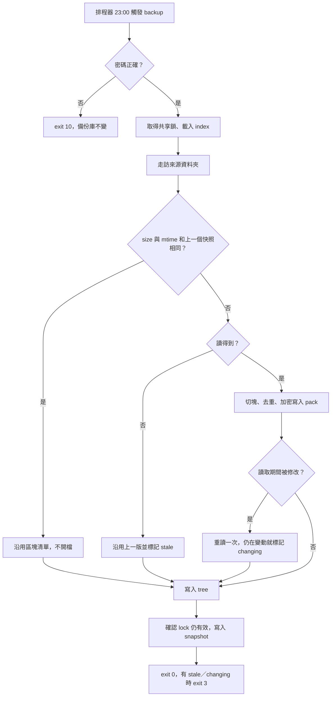
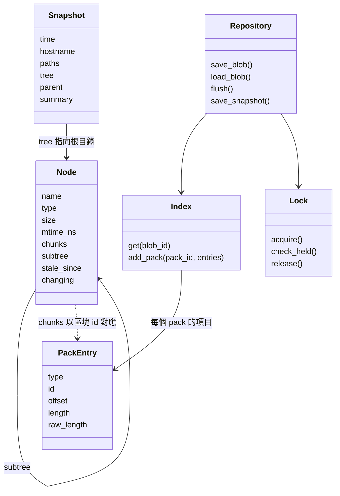
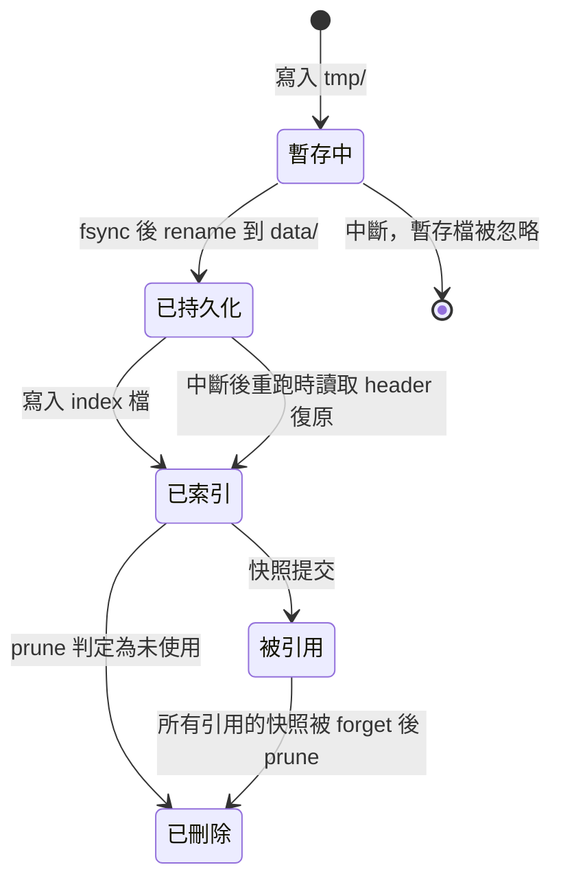
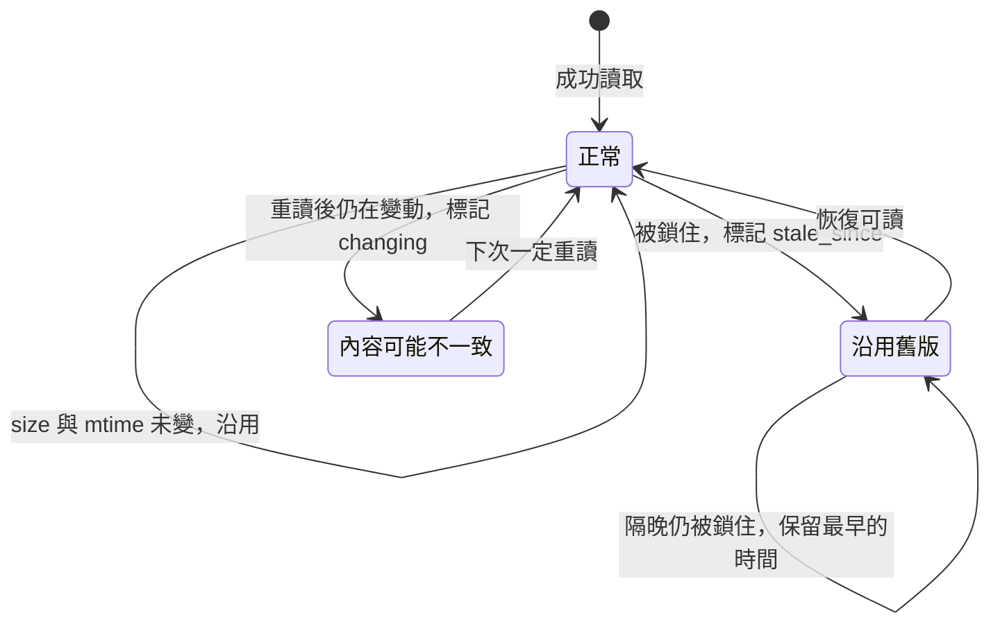

# 02 系統分析

這一章把需求拆解成系統行為：主要流程、使用情境、領域模型，以及需求和程式碼的對應。

## 1. 主要業務流程：每晚的自動備份

這張圖要看的是「被鎖住的檔案」與「中途被修改的檔案」各自走哪條路。兩條路都會讓這一晚以 exit code 3 結束，但都不會讓檔案從快照中消失。

## 2. 核心使用情境

### 情境一：每晚自動備份

- **前置條件**：備份庫已 `init`；密碼放在 `--password-file` 或環境變數；外接硬碟已接上。
- **主要步驟**：驗證密碼 → 取得共享鎖 → 讀取上一個快照（parent）→ 只讀取有變動的檔案 → 寫入 pack 與 index → 寫入 snapshot。
- **例外情況**：
  - 檔案被其他程式鎖住：沿用上一版，標記 stale。
  - 硬碟被拔除：`RepositoryUnavailableError`，exit 12。下次重跑時，會沿用已寫入的 pack。
  - 另一台電腦正在 prune：拒絕執行，exit 11。

### 情境二：還原某個資料夾

- **前置條件**：知道快照 ID（或使用 `latest`），以及快照內的路徑。
- **主要步驟**：`restore latest:/Users/mom/Pictures/2024 -t ~/restore` → 取得共享鎖 → 找到節點 → 逐區塊解密、驗證 HMAC → 先寫成 `.hv-partial` 再改名 → 最後以後序設定目錄 mtime。
- **例外情況**：
  - 目標檔案已存在：略過並警告（除非加上 `--overwrite`）。
  - 某個區塊損毀：記錄錯誤，繼續還原其他檔案，exit 3。

### 情境三：清理舊快照

- **前置條件**：沒有其他電腦正在執行 backup（backup 持有共享鎖時無法取得獨佔鎖）。
- **主要步驟**：`forget --keep-daily 7 --keep-weekly 4 --keep-monthly 12 --prune` → 依「主機＋來源路徑」分組套用保留政策 → 刪除 snapshot 檔 → prune：找出仍在使用的區塊、重新打包、寫新 index、刪舊 index、刪 pack。
- **例外情況**：任何快照的 tree 讀不到 → prune 中止，不刪除任何東西。

## 3. 領域模型

這張圖只列關鍵屬性。重點是兩條引用鏈：

- 「Snapshot → Node（tree）→ 區塊 id」是**內容的邏輯結構**；
- 「Index → Pack → PackEntry」是**區塊的實體位置**。

兩條鏈只透過「區塊 id」相連。

## 4. 狀態轉換

### Pack 檔的生命週期

中斷安全的關鍵在於：**pack 只有在「已持久化」之後才會被 index 記錄，snapshot 只會引用已被記錄的區塊。** 任何一個中斷點，pack 都只會停在下圖的某個狀態上。

### 快照中的檔案節點

## 5. 需求追溯表

| 需求 | 實作位置 |
|---|---|
| FR-01 CDC 切塊 | `src/homevault/chunker.py` |
| FR-02 去重 | `Repository.save_blob()`（`src/homevault/repository.py`）、`src/homevault/index.py` |
| FR-03 壓縮與 pack | `src/homevault/pack.py` |
| FR-04、FR-05、FR-06 加密、HMAC、密碼 | `src/homevault/crypto.py`、`Repository.open()` |
| FR-07、FR-08、FR-09 快照、增量、排除 | `src/homevault/backup.py`、`src/homevault/tree.py`、`src/homevault/snapshot.py` |
| FR-10、FR-11 還原 | `src/homevault/restore.py` |
| FR-12 列出、瀏覽、比較 | `src/homevault/cli.py`（`cmd_snapshots`、`cmd_ls`）、`src/homevault/browse.py` |
| FR-13 保留政策 | `src/homevault/retention.py`、`src/homevault/forget.py` |
| FR-14 prune | `src/homevault/prune.py` |
| FR-15、FR-16 check | `src/homevault/check.py` |
| FR-17 stats | `src/homevault/stats.py` |
| FR-18 進度 | `Progress`（`src/homevault/backup.py`）、`ProgressReporter`（`src/homevault/cli.py`） |
| FR-19、FR-20 中斷安全 | `src/homevault/storage.py`、`Repository.load_index()`、`src/homevault/prune.py` 的步驟順序 |
| FR-21、FR-22 被鎖住或變動中的檔案 | `_Archiver._reuse_previous()`、`_Archiver._store_file()`（`src/homevault/backup.py`） |
| FR-23 lock 失效偵測 | `Lock.check_held()`（`src/homevault/locking.py`） |
