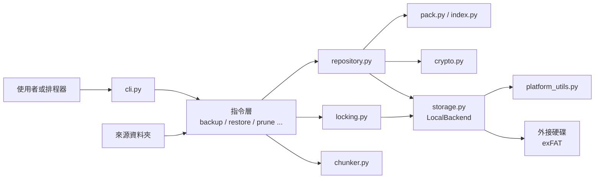
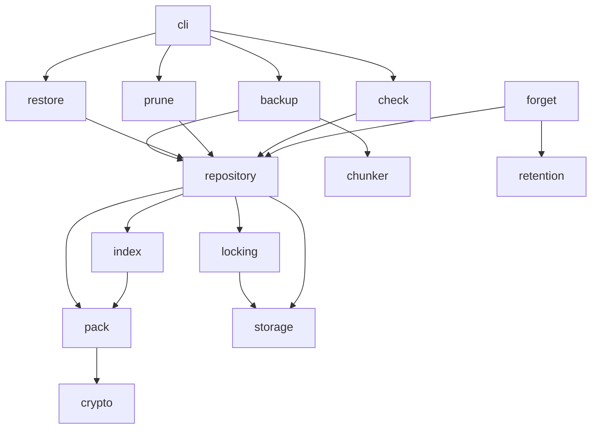

# 03 架構設計

## 1. 整體架構

HomeVault 是單一行程的 CLI 工具，沒有伺服器，也沒有資料庫。唯一的「外部系統」是外接硬碟上的備份庫目錄。這張圖要看的是：**所有對備份庫的存取都經過 `LocalBackend` 這一個出口**。



## 2. 分層與職責

| 層 | 模組 | 職責 | 不做的事 |
|---|---|---|---|
| 介面層 | `cli.py`、`__main__.py` | 解析參數、讀密碼、輸出格式、把例外轉成 exit code | 不含任何業務邏輯 |
| 指令層 | `backup.py`、`restore.py`、`browse.py`、`forget.py`、`prune.py`、`check.py`、`stats.py` | 一個指令一個模組，負責流程協調與寫入順序 | 不直接操作檔案路徑 |
| 備份庫核心 | `repository.py`、`index.py`、`pack.py`、`tree.py`、`snapshot.py`、`locking.py` | 格式、去重、pack 的封裝與索引 | 不知道來源資料夾長什麼樣 |
| 基礎元件 | `chunker.py`、`crypto.py`、`retention.py` | 純函式，不碰檔案系統 | — |
| 儲存層 | `storage.py`、`platform_utils.py` | 原子寫入、fsync、錯誤轉換、作業系統差異 | 不知道檔案內容的意義 |

> 📄 依據：`docs/design.md` §3.1。設計討論時列出的原則是：「所有寫入經過 `Backend`」、「保留政策、切塊、加密是純函式」、「指令層不直接操作檔案路徑」。

## 3. 目錄結構

```
HomeVault/
├── src/homevault/
│   ├── cli.py             進入點：argparse、密碼來源、進度顯示、exit code
│   ├── errors.py          例外階層，每種例外對應一個 exit code
│   ├── chunker.py         FastCDC：numpy 版與純 Python 參考實作
│   ├── crypto.py          scrypt、AES-GCM、HMAC 區塊 id、key file
│   ├── storage.py         LocalBackend：tmp→fsync→rename，基本操作可被覆寫
│   ├── platform_utils.py  F_FULLFSYNC、MoveFileExW、行程優先權、pid 存活
│   ├── pack.py            blob 編碼與 pack 檔格式（header 在檔尾）
│   ├── index.py           記憶體索引與 index 檔格式
│   ├── tree.py            目錄節點（Merkle tree）
│   ├── snapshot.py        快照
│   ├── repository.py      開啟/初始化、save_blob、flush、快照存取
│   ├── locking.py         共享鎖／獨佔鎖、殘留判定、check_held
│   ├── backup.py          走訪、增量判斷、平行讀檔、stale 與 changing
│   ├── restore.py         還原、find_node
│   ├── browse.py          diff
│   ├── retention.py       保留政策（純函式）
│   ├── forget.py / prune.py / check.py / stats.py
├── tests/                 每個模組一個測試檔，faults.py 是故障注入後端
├── benchmarks/            500 MiB 效能量測、跨 OS 去重腳本（CI 使用）
└── docs/design.md         開發前的系統分析與架構設計
```

## 4. 模組相依關係

這張圖要看的是**相依方向一律由上往下**，沒有循環。基礎元件（`chunker`、`crypto`、`retention`）不相依任何專案內模組，所以可以單獨測試。



## 5. 使用到的設計模式

### 接縫（Seam）：可覆寫的基本操作

`LocalBackend` 把所有會改變狀態的動作拆成 `_op_write`、`_op_fsync`、`_op_rename`、`_op_delete`、`_op_mkdir` 五個方法。測試用的 `FaultInjectingBackend`（`tests/faults.py`）繼承它並覆寫這五個方法，就能在任一個操作上模擬當機。

- **為什麼這樣做：** 故障注入的需求（驗收 10）要求在至少 20 個位置模擬中斷。如果寫入散落在各模組，就沒有一個地方可以攔截。
- **不這樣做會怎樣：** 只能用 monkeypatch 去攔截 `os.replace` 之類的函式，脆弱且容易漏掉。

> 📄 依據：`docs/design.md` §3.1「所有對備份庫的寫入都經過 `Backend` 介面，這是故障注入測試的接縫」

### 內容定址（Content Addressing）

- blob 的 id 是內容的 HMAC。
- pack、index、snapshot 的檔名是密文的 SHA-256。

同一份內容一定得到同一個名字，所以去重只要查表；同時檔名也是校驗碼。

### Merkle 樹

每個目錄是一個 tree blob，id 由內容決定。子目錄沒有變動時，id 也不變，所以會自動去重；`diff` 遇到子樹 id 相同時可以整段跳過。詳見 [05 章](05-database.md)。

### 寫入順序即協定（Write Ordering as Protocol）

這裡沒有交易（transaction），而是靠「被引用者先寫、引用者後寫」，再加上「snapshot 是 commit point」來保證一致性。這是整個專案最核心的設計，詳見 [11 章](11-tradeoffs-pitfalls.md) 與 README。

## 6. 橫切關注點

| 關注點 | 做法 | 位置 |
|---|---|---|
| 錯誤處理 | 自訂例外階層，每個類別帶 `exit_code`；`cli.main()` 統一攔截並輸出中文訊息 | `src/homevault/errors.py`、`src/homevault/cli.py` |
| I/O 錯誤分類 | `LocalBackend._io()` 把 `OSError` 分成「硬碟被拔除」（`RepositoryUnavailableError`）與「備份庫缺檔」（`ObjectMissingError`） | `src/homevault/storage.py` |
| 日誌 | 使用 `logging.getLogger("homevault")`；CLI 安裝的 handler 會把等級轉成「警告：」「錯誤：」前綴 | `cli._setup_logging()` |
| 輸出編碼 | 輸出被導向時，Windows 會改用 cp1252/cp950；`ensure_utf8_output()` 改回 UTF-8 | `src/homevault/cli.py` |
| 並行控制 | 備份庫層級用 lock 檔；行程內用標準函式庫的 threading.Lock 保護 pack 與 index | `src/homevault/locking.py`、`Repository._lock` |
| 設定 | 備份庫參數（切塊大小、pack 大小）寫在備份庫的 `config`，不放在使用者電腦上，兩台電腦因此一致 | `RepoConfig`（`src/homevault/repository.py`） |
| 驗證 | 讀取端不信任任何檔案：AES-GCM tag、HMAC 比對、檔名等於 SHA-256 | `pack.decode_blob()`、`check.py` |
