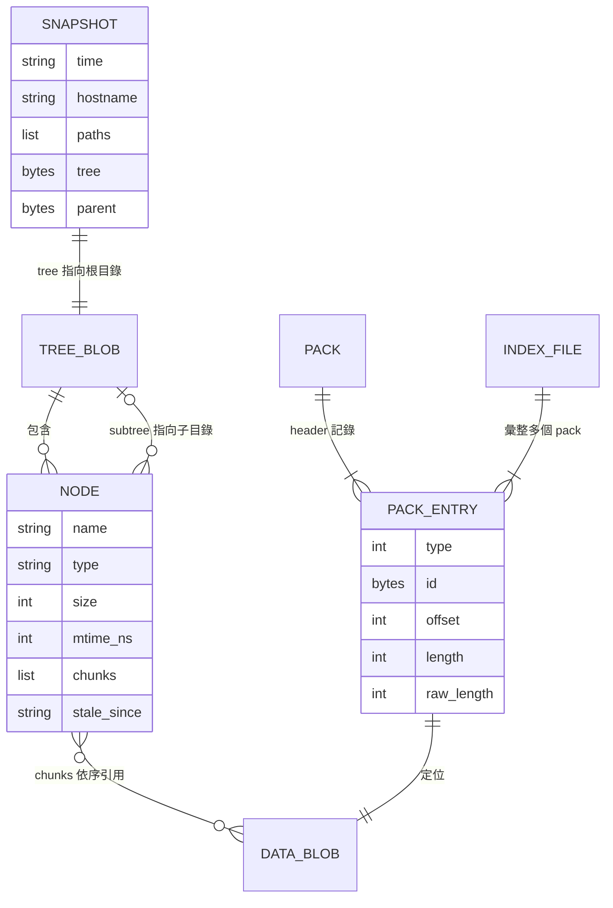

# 05 資料儲存設計（備份庫格式）

> 本專案沒有資料庫（📄 題目規定「不需要資料庫」）。本章改寫為**備份庫格式**的設計：這就是 HomeVault 的資料層，也是整個專案中「資料怎麼存、為什麼這樣設計」的核心。

## 1. 實體關係

這張圖要看的是兩組關係：

- 左半部是**邏輯結構**：快照指向目錄樹，目錄樹的節點以 id 引用區塊；
- 右半部是**實體位置**：index 記錄每個區塊在哪個 pack 的哪個位置。



## 2. 目錄配置

| 路徑 | 內容 | 加密 | 檔名 |
|---|---|---|---|
| `config` | 格式版本、repo id、切塊參數、pack 大小 | 否（不含任何內容資訊） | 固定 |
| `keys/<名稱>` | scrypt 參數、salt、被加密的 master key | 部分（master key 加密） | key file 內容的 SHA-256 |
| `data/<前 2 碼>/<名稱>` | pack 檔 | 是 | **pack 密文的 SHA-256** |
| `index/<名稱>` | 索引 | 是 | 密文的 SHA-256 |
| `snapshots/<名稱>` | 快照 | 是 | 密文的 SHA-256 |
| `locks/<名稱>` | lock | 是 | 隨機值 |
| tmp/ | 寫入中的暫存檔 | — | 隨機值 |

**設計重點：**

- **只新增、不覆寫。** 除了 lock 之外，所有檔案寫入之後內容就不再改變。檔名由內容決定，同名就代表同內容。
- **備份庫的 data/ 目錄分成 256 個子目錄。** 2 TB ÷ 16 MiB ≈ 12.5 萬個 pack，分散後每個目錄約 500 個檔案。
- **檔名全部是小寫 hex。** exFAT 不分大小寫，這樣可以避免衝突。
- **`config` 最後寫入。** `Repository.init()` 先建立目錄與 key file，最後才寫 `config`。所以 `config` 存在，就代表初始化已經完成。

## 3. 各結構的欄位

### Blob（儲存的最小單位）

| 項目 | 內容 |
|---|---|
| 類型 | `DATA`（檔案區塊）或 `TREE`（目錄節點清單），見 `BlobType`（`src/homevault/pack.py`） |
| 識別碼 | `HMAC-SHA256(mac_key, 明文)`，見 `MasterKey.blob_id()`（`src/homevault/crypto.py`） |
| 編碼 | `明文 → zstd（沒變小就存原文，以 1 byte flag 標示）→ AES-GCM` |
| AAD | `type ∥ blob_id`：blob 被調換，或 index 指錯位置時，解密會失敗 |

### Pack 檔

```
[加密 blob][加密 blob]...[加密 header][header 長度 u32 little-endian]
header 明文 = 筆數 u32 + 每筆（type u8 ∥ id 32B ∥ offset u32 ∥ length u32 ∥ raw_length u32）
```

**為什麼把 header 放在檔尾？** 這樣可以邊寫邊串流，不必事先知道有哪些 blob。而且 pack 可以自我描述：index 遺失時，只要讀 pack 檔尾就能重建索引。這正是中斷復原的基礎（`Repository.load_index(recover_orphans=True)`）。

### Index 檔

```
"HVIX" ∥ 版本 u8 ∥ pack 數 u32 ∥ 每個 pack（pack_id 32B ∥ 項目清單，格式同 header）
→ zstd → AES-GCM
```

一次備份會寫出一個或多個 index 檔：每 64 個 pack 寫一次 checkpoint，結束時再寫一次。prune 會把它們合併成新的 index 檔，每個檔案最多 5 萬筆。

### Tree blob

依名稱排序的節點清單，以 JSON 表示。只在欄位有值時才寫入 `dir`、`stale_since`、`changing`。這樣新增欄位時，舊有 tree 的內容與 id 都不會改變，去重也就不會因此失效。

### Snapshot

時間（含建立時的本地時區 offset）、主機名稱、來源路徑、根 tree id、parent 快照 id、標籤，以及統計資料（含 `files_stale`、`files_changing`）。

## 4. 「正規化」與刻意的重複

- **同一個 blob 可以同時存在於多個 pack**，這是刻意允許的：中斷後重寫、prune 的過渡狀態都會產生重複。index 載入時會合併（`Index.add_pack()` 以第一次出現的位置為準），prune 會回收多餘的副本。
- **快照的統計資料是重複儲存的**（`Snapshot.summary`）。它們可以從 tree 重新算出來，但每次列出快照都走訪整棵樹太慢，所以在建立快照時一併寫入。

## 5. 記憶體中的索引

`Index`（`src/homevault/index.py`）把每個 blob 的位置編碼成**一個整數**：

```python
# src/homevault/index.py（Index.add_pack 節錄）
self._blobs[e.id] = (
    pack_no << 97
    | int(e.type) << 96
    | e.offset << 64
    | e.length << 32
    | e.raw_length
)
```

**為什麼這樣做：** 2 TB 約有 200 萬個 blob。如果每筆用 dataclass 或 tuple 存，Python 物件的額外負擔會讓記憶體翻倍。改用一個整數後，每筆約 150 bytes，200 萬筆約 300 MB。

**代價：** 讀取時要再解碼（`Index.get()`），而且 offset、length 都受限在 32 bits 以內。這對 16 MiB 的 pack 綽綽有餘。

## 6. 查詢重點

| 操作 | 成本 | 說明 |
|---|---|---|
| 去重判斷 | O(1) | 查 `Index` 的 dict |
| 載入 index | 讀取全部 index 檔，並列出備份庫的 data/ 目錄 | 指向不存在 pack 的項目會被忽略 |
| 中斷復原 | 每個沒有被索引的 pack 讀一次檔尾 | 每 64 個 pack 寫一次 checkpoint，限制需要復原的數量 |
| 走訪快照 | 每個目錄讀一個 tree blob | 共用的子樹只走訪一次（`Repository.walk_blobs()`） |
