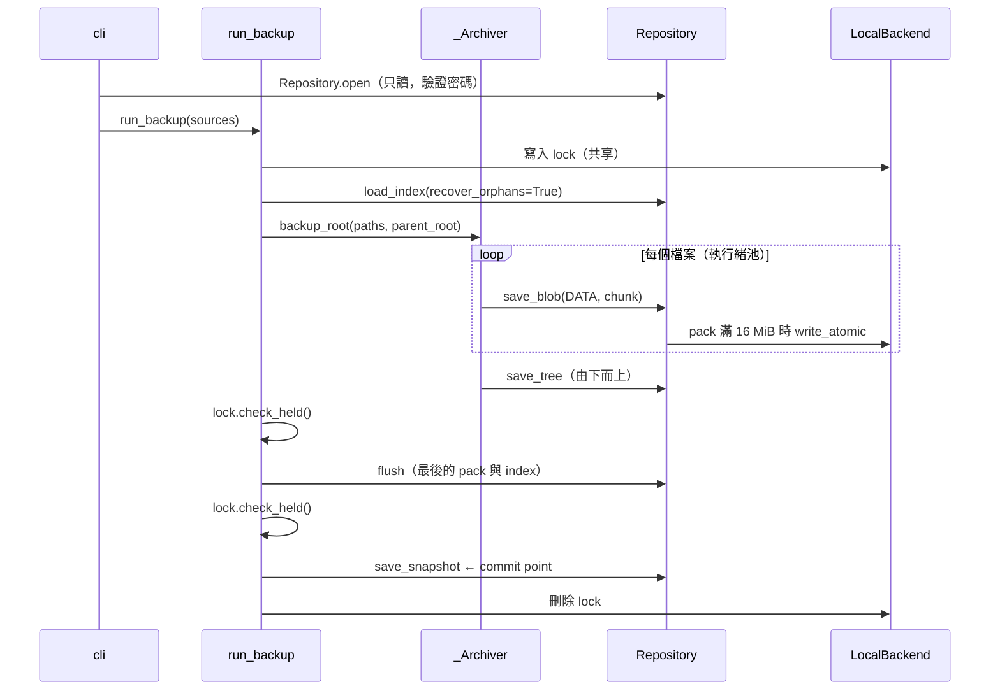
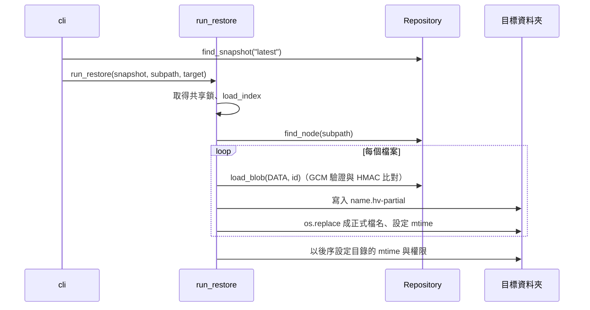
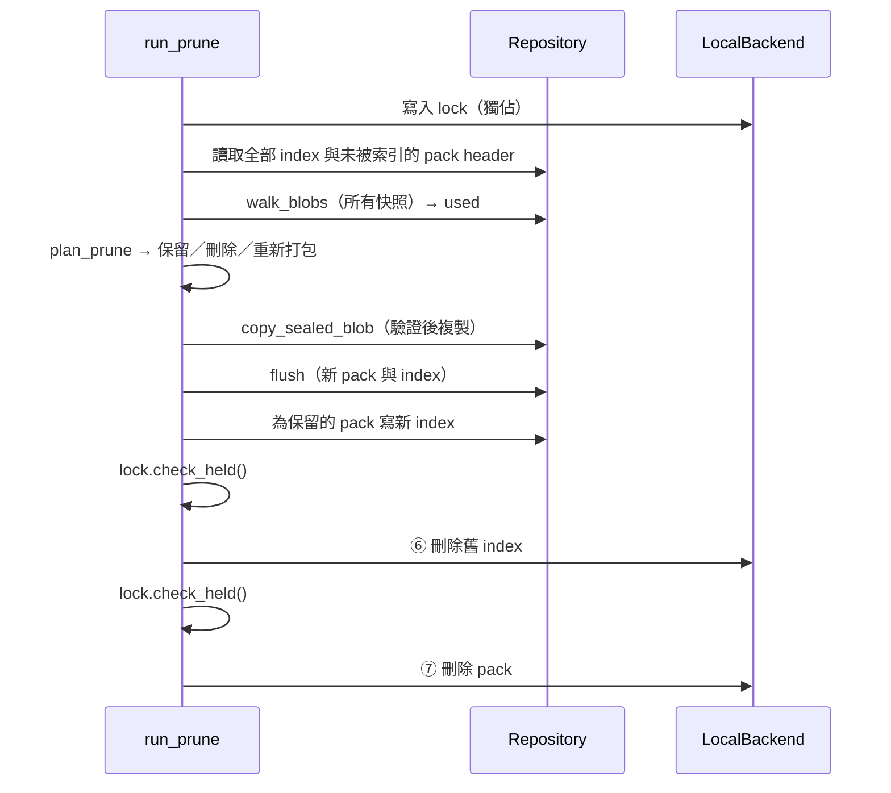
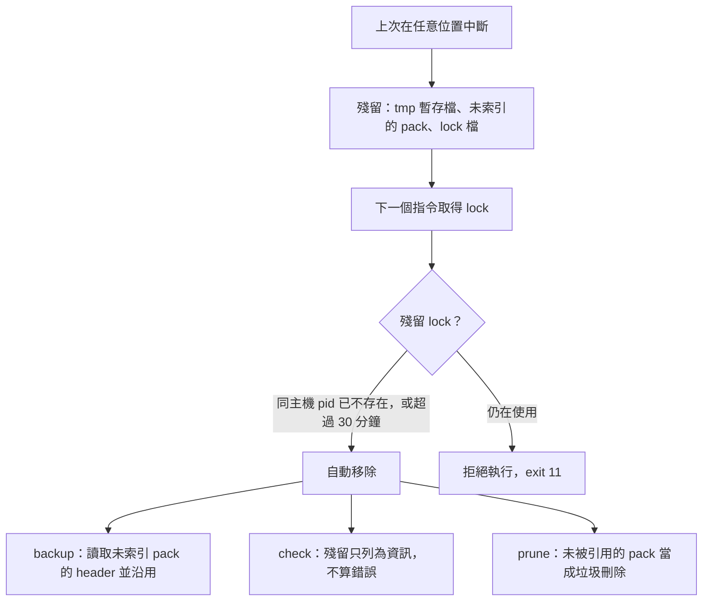

# 06 輸入／輸出介面與資料流

> 本專案是 CLI 工具，沒有 HTTP API。本章改寫為命令列介面、輸入輸出，以及核心流程的資料流。

## 1. 命令列介面

所有指令都共用以下選項：`--repo`（或環境變數 `HOMEVAULT_REPO`）、`--password-file`、`-q`、`-v`。處理函式都在 `src/homevault/cli.py`。

| 指令 | 用途 | 鎖 | 處理函式 → 核心函式 |
|---|---|---|---|
| `init` | 建立備份庫 | 無 | `cmd_init` → `Repository.init()` |
| `backup <來源...>` | 建立快照 | 共享 | `cmd_backup` → `run_backup()` |
| `snapshots` | 列出快照（含 ⚠ 標示） | 無 | `cmd_snapshots` |
| `ls <快照>[:路徑]` | 瀏覽 | 共享 | `cmd_ls` → `find_node()` |
| `restore <快照>[:路徑] -t <目標>` | 還原 | 共享 | `cmd_restore` → `run_restore()` |
| `diff A B` | 比較 | 共享 | `cmd_diff` → `diff_snapshots()` |
| `check [--read-data]` | 完整性檢查 | 共享 | `cmd_check` → `run_check()` |
| `forget --keep-*` | 套用保留政策 | 獨佔 | `cmd_forget` → `run_forget()` |
| `prune` | 回收空間 | 獨佔 | `cmd_prune` → `run_prune()` |
| `stats` | 統計 | 共享 | `cmd_stats` → `run_stats()` |
| `unlock [--all]` | 清除殘留 lock | 無 | `cmd_unlock` |

### 密碼來源

依序嘗試：`--password-file`、環境變數 `HOMEVAULT_PASSWORD`、終端機互動輸入（`cli.read_password()`）。沒有終端機時（排程執行），三者都不可用就以 exit 2 結束，並說明如何提供密碼。

### Exit code

由 `src/homevault/errors.py` 的例外類別決定：

| 代碼 | 例外 | 情況 |
|---|---|---|
| 0 | — | 成功 |
| 1 | `HomeVaultError`、`NotFoundError`、`RepositoryNotFoundError` | 一般錯誤、找不到快照或路徑、不是備份庫 |
| 2 | `UsageError` | 參數錯誤 |
| 3 | — | 部分成功：有沿用舊版、變動中、無法備份或無法還原的項目 |
| 10 | `WrongPasswordError` | 密碼錯誤 |
| 11 | `RepositoryLockedError` | 被另一台電腦鎖定，或 lock 在執行中失效 |
| 12 | `RepositoryUnavailableError` | 硬碟被拔除 |
| 13 | `IntegrityError` | 資料損毀 |
| 130 | — | Ctrl+C |

### 快照參照語法

`<快照>[:路徑]`。快照可以寫 `latest` 或 ID 前綴；路徑接受 `/Users/mom/Pictures`、`C:\Users\Dad`、`/C/Users/Dad` 等寫法。Windows 的磁碟代號會被轉成快照內的 `C` 元件，見 `find_node()`（`src/homevault/restore.py`）。

## 2. 核心流程一：backup

這張圖要看的是**兩次 `check_held()` 的位置**，以及 **snapshot 是最後才寫的**。

## 3. 核心流程二：restore

## 4. 核心流程三：prune

這張圖要看的是兩個刪除步驟的順序：**先刪舊 index，再刪 pack**。這是最容易出錯的地方，原因見 [11 章](11-tradeoffs-pitfalls.md)。

## 5. 核心流程四：中斷之後

當機後下一個指令會遇到什麼？這張圖說明「殘留物」怎麼被自然消化，不需要任何修復指令。

## 6. 輸出產物

| 產物 | 位置 | 說明 |
|---|---|---|
| 備份結果摘要 | stdout | 新增、修改、未變動的檔案數；讀取速度；新增資料量；去重率；沿用舊版或變動中的檔案清單 |
| 進度 | stderr | 終端機上單行更新（0.5 秒一次）；被導向檔案時每 30 秒輸出一行，見 `ProgressReporter` |
| 警告與錯誤 | stderr | 「警告：」「錯誤：」前綴 |

輸出一律使用 UTF-8（`ensure_utf8_output()`），所以 Windows 排程把輸出導向 log 檔時，遇到中文或 emoji 不會出錯。
